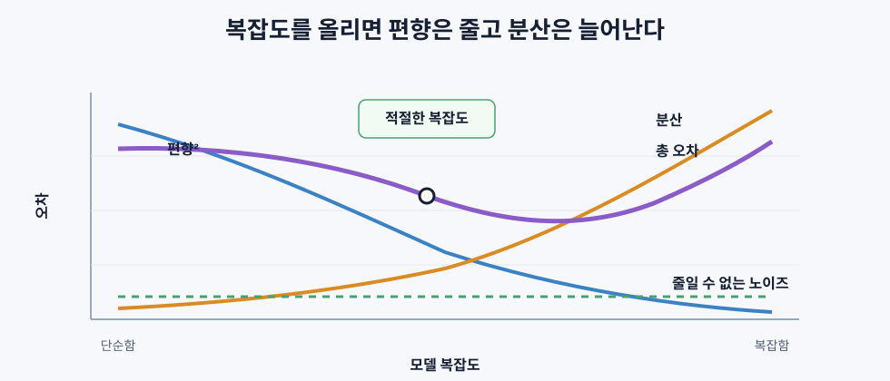
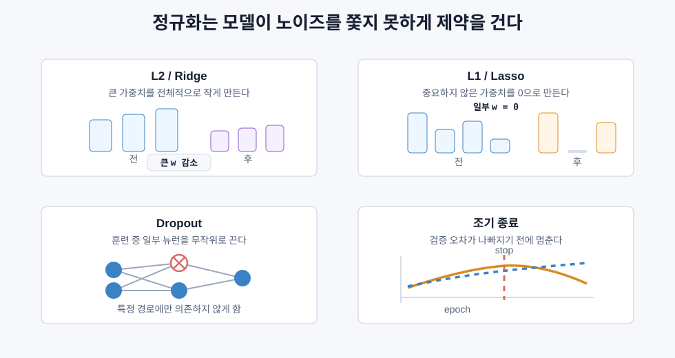
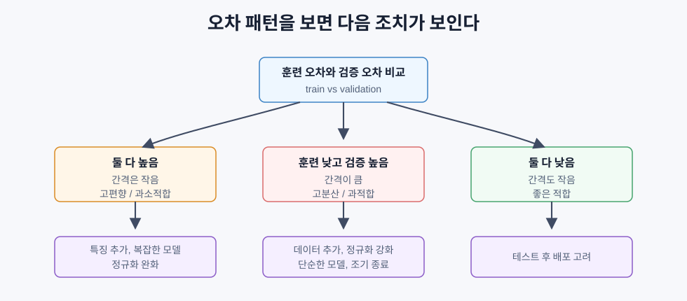
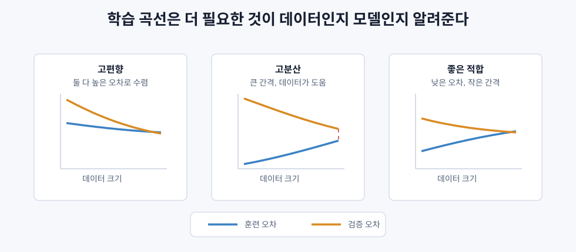
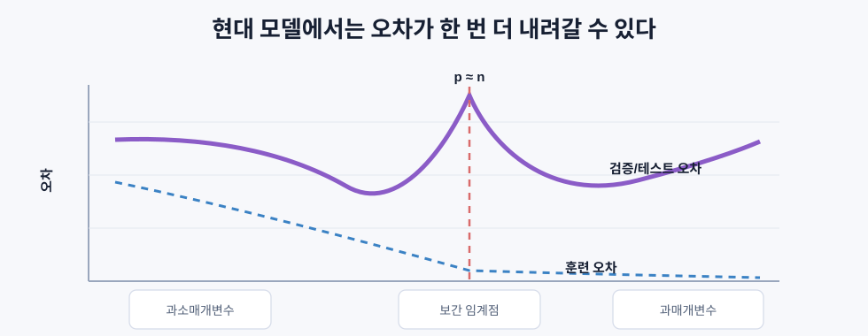

# 편향-분산 트레이드오프

> 모델의 예측 오차는 크게 편향, 분산, 줄일 수 없는 노이즈에서 온다. 우리가 조절할 수 있는 것은 주로 편향과 분산이다.

## 핵심 아이디어

모델이 틀렸을 때는 단순히 “성능이 낮다”에서 멈추면 안 된다. 왜 틀렸는지 봐야 한다.

모델이 너무 단순하면 실제 패턴을 못 잡는다. 직선으로 곡선을 맞추려는 상황이 그렇다. 이때는 훈련 데이터에서도 잘 못 맞히고, 새 데이터에서도 잘 못 맞힌다. 이것이 고편향이다.

반대로 모델이 너무 복잡하면 훈련 데이터의 노이즈까지 외운다. 훈련 데이터에서는 거의 완벽하지만 새 데이터에서는 흔들린다. 이것이 고분산이다.

```text
고편향 = 모델이 너무 단순해서 패턴을 놓침
고분산 = 모델이 너무 복잡해서 훈련 데이터에 민감함
```

좋은 모델은 편향도 너무 크지 않고, 분산도 너무 크지 않은 지점에 있다.



## 편향

편향은 모델의 평균 예측값이 실제 값에서 얼마나 벗어나 있는지를 뜻한다. 여러 훈련 데이터셋으로 같은 모델을 학습했을 때, 평균적인 예측이 계속 같은 방향으로 틀리면 편향이 크다.

```text
Bias^2 = (E[f_hat(x)] - f(x))^2
```

- `f(x)`: 실제 정답을 만드는 함수
- `f_hat(x)`: 학습된 모델의 예측
- `E[f_hat(x)]`: 여러 훈련 데이터셋에서 얻은 예측의 평균

편향이 높다는 것은 모델이 실제 패턴을 잡기에는 너무 단순하다는 뜻이다. 포물선에 직선을 맞추는 경우처럼, 데이터가 많아도 구조 자체를 놓친다. 이것이 과소적합이다.

```text
고편향 신호:
훈련 오차 높음
검증/테스트 오차 높음
둘 사이의 간격은 작음
```

## 분산

분산은 훈련 데이터가 조금 바뀌었을 때 모델 예측이 얼마나 흔들리는지를 뜻한다.

```text
Variance = E[(f_hat(x) - E[f_hat(x)])^2]
```

고분산 모델은 훈련 데이터의 작은 변화에도 결정 경계나 예측 곡선이 크게 바뀐다. 훈련 데이터의 우연한 노이즈까지 패턴처럼 외웠기 때문이다.

고분산 모델은 보통 과적합이다.

```text
고분산 신호:
훈련 오차 낮음
검증/테스트 오차 높음
둘 사이의 간격이 큼
```

예를 들어 데이터가 15개뿐인데 20차 다항식을 맞추면, 훈련 점들을 거의 모두 통과할 수 있다. 하지만 그 사이 구간에서는 예측이 크게 흔들릴 수 있다.

## 줄일 수 없는 노이즈

데이터 자체에 들어 있는 무작위성은 어떤 모델도 제거할 수 없다. 같은 조건의 집이라도 실제 가격은 협상, 시점, 주변 상황 때문에 달라질 수 있다. 같은 증상을 가진 환자라도 결과가 항상 같지는 않다.

이런 오차를 줄일 수 없는 노이즈, 또는 irreducible error라고 한다.

```text
Noise = E[(y - f(x))^2] = sigma^2
```

모델링의 목표는 노이즈를 0으로 만드는 것이 아니다. 노이즈는 남는다고 인정하고, 편향과 분산을 적절히 줄이는 것이다.

## 오차 분해

제곱오차 기준에서 기대 예측 오차는 다음처럼 분해된다.

```text
Expected Error = Bias^2 + Variance + Irreducible Noise
```

각 항의 의미는 다음과 같다.

| 항 | 의미 | 줄이는 방법 |
|---|---|---|
| 편향² | 평균적으로 잘못된 방향으로 예측하는 오차 | 더 유연한 모델, 더 좋은 특징 |
| 분산 | 훈련 데이터 변화에 민감해서 생기는 오차 | 더 많은 데이터, 정규화, 단순한 모델 |
| 노이즈 | 데이터 생성 과정의 무작위성 | 보통 제거 불가 |

중요한 점은 편향과 분산을 동시에 마음껏 낮출 수 없다는 것이다. 모델을 복잡하게 만들면 편향은 줄지만 분산이 늘 수 있다. 모델을 단순하게 만들면 분산은 줄지만 편향이 늘 수 있다.

## 모델 복잡도와 오차

모델 복잡도가 너무 낮으면 고편향이다. 모델 복잡도가 너무 높으면 고분산이다. 중간 어딘가에 검증 오차가 가장 낮은 지점이 있다.

| 복잡도 | 편향 | 분산 | 상태 |
|---|---|---|---|
| 너무 낮음 | 높음 | 낮음 | 과소적합 |
| 적절함 | 중간 | 중간 | 좋은 일반화 |
| 너무 높음 | 낮음 | 높음 | 과적합 |

## 정규화는 편향-분산 조절 장치

정규화는 모델을 일부러 덜 자유롭게 만드는 방법이다. 즉 편향을 조금 늘리는 대신 분산을 줄인다.

| 방법 | 효과 |
|---|---|
| L2, Ridge | 큰 가중치를 줄여 모델을 부드럽게 만든다 |
| L1, Lasso | 일부 가중치를 0으로 만들어 특징 선택 효과를 낸다 |
| Dropout | 일부 뉴런을 무작위로 꺼서 특정 경로 의존을 줄인다 |
| 조기 종료 | 훈련 데이터를 끝까지 외우기 전에 멈춘다 |



정규화가 너무 약하면 분산이 커질 수 있다. 정규화가 너무 강하면 모델이 너무 단순해져 편향이 커진다.

```text
정규화 약함 -> 낮은 편향, 높은 분산
정규화 강함 -> 높은 편향, 낮은 분산
```

## 훈련 오차와 검증 오차로 진단하기

편향과 분산은 훈련 오차와 검증 오차의 패턴으로 어느 정도 진단할 수 있다.



| 증상 | 진단 | 조치 |
|---|---|---|
| 훈련 오차 높음, 검증 오차 높음 | 고편향 | 더 복잡한 모델, 특징 추가, 정규화 완화 |
| 훈련 오차 낮음, 검증 오차 높음 | 고분산 | 데이터 추가, 정규화 강화, 단순한 모델 |
| 훈련 오차 낮음, 검증 오차 낮음 | 좋은 적합 | 테스트 확인 후 배포 고려 |
| 훈련 오차는 계속 감소, 검증 오차는 증가 | 과적합 진행 중 | 조기 종료 |

이 진단은 모델 개선 방향을 정하는 데 매우 중요하다.

```text
고편향인데 데이터를 더 모으는 것:
대개 큰 도움이 안 된다.

고분산인데 모델을 더 복잡하게 만드는 것:
대개 상황을 악화시킨다.
```

## 편향이 문제일 때

고편향은 모델이 실제 패턴을 표현할 힘이 부족하다는 뜻이다.

해결 방향:

- 다항 특징이나 상호작용 특징을 추가한다.
- 선형 모델 대신 트리 앙상블처럼 더 유연한 모델을 쓴다.
- 정규화 강도를 낮춘다.
- 아직 수렴하지 않았다면 더 오래 학습한다.

고편향에서는 훈련 오차 자체가 높다. 모델이 훈련 데이터도 못 맞추는 상태이므로, 먼저 모델의 표현력을 키워야 한다.

## 분산이 문제일 때

고분산은 모델이 훈련 데이터에 너무 민감하다는 뜻이다.

해결 방향:

- 훈련 데이터를 더 모은다.
- 정규화를 강화한다.
- 모델을 단순하게 만든다.
- 노이즈가 큰 특징을 제거한다.
- 교차검증으로 불안정성을 확인한다.
- 배깅이나 랜덤 포레스트처럼 평균으로 흔들림을 줄인다.

고분산에서는 훈련 성능이 이미 좋다. 따라서 모델을 더 강하게 만들기보다, 흔들림을 줄이는 쪽이 우선이다.

## 앙상블과 분산 감소

앙상블은 여러 모델의 예측을 합치는 방법이다. 특히 배깅은 분산을 줄이는 데 강하다.

배깅은 훈련 데이터에서 여러 부트스트랩 샘플을 만들고, 각 샘플로 모델을 학습한 뒤 예측을 평균낸다.

```text
개별 모델의 분산 = sigma^2
서로 독립인 N개 모델의 평균 분산 = sigma^2 / N
```

실제로 모델들이 완전히 독립은 아니므로 정확히 `1/N`만큼 줄지는 않는다. 그래도 서로 다른 데이터 샘플을 본 모델들의 평균은 단일 모델보다 안정적이다. 랜덤 포레스트가 대표적인 예다.

부스팅은 성격이 조금 다르다. 약한 모델을 순차적으로 쌓아 이전 모델의 오류를 보완한다. 그래서 주로 편향을 줄이는 데 강하지만, 너무 많이 쌓으면 분산이 커져 과적합될 수 있다.

| 방법 | 주된 효과 | 주의할 점 |
|---|---|---|
| 배깅 | 분산 감소 | 모델들이 너무 비슷하면 효과가 줄어듦 |
| 랜덤 포레스트 | 트리의 높은 분산 완화 | 해석이 단일 트리보다 어려움 |
| 부스팅 | 편향 감소 | 너무 오래 학습하면 과적합 가능 |
| Dropout | 암묵적 앙상블 효과 | 너무 강하면 과소적합 |

## 학습 곡선

학습 곡선은 훈련 데이터 크기에 따라 훈련 오차와 검증 오차가 어떻게 변하는지 보여준다.



학습 곡선을 보면 “데이터를 더 모으면 도움이 될까?”를 판단할 수 있다.

| 패턴 | 의미 | 조치 |
|---|---|---|
| 둘 다 높고 간격이 작음 | 고편향 | 모델/특징을 바꿔야 함 |
| 훈련 낮고 검증 높음, 간격 큼 | 고분산 | 데이터 추가나 정규화가 도움 |
| 둘 다 낮고 간격 작음 | 좋은 적합 | 현재 방향 유지 |
| 검증 오차가 데이터 증가와 함께 계속 감소 | 데이터가 더 도움됨 | 더 모을 가치 있음 |
| 둘 다 높게 평평함 | 데이터만 늘려도 해결 어려움 | 모델 복잡도 조정 |

학습 곡선과 함께 검증 곡선도 자주 본다. 검증 곡선은 데이터 크기가 아니라 모델 복잡도나 정규화 강도를 바꿔가며 훈련/검증 오차를 비교한다.

```text
학습 곡선:
훈련 데이터 크기를 바꾼다.

검증 곡선:
모델 복잡도나 정규화 강도를 바꾼다.
```

## Double Descent

고전적인 설명에서는 모델 복잡도가 커지면 검증 오차가 U자형으로 움직인다. 어느 지점까지는 좋아지다가, 너무 복잡해지면 과적합으로 나빠진다는 설명이다.

하지만 큰 신경망 같은 현대 모델에서는 더 복잡한 현상이 관찰된다. 모델이 훈련 데이터를 완벽히 맞출 수 있는 보간 임계점 근처에서는 오차가 크게 튀지만, 그보다 훨씬 더 큰 모델에서는 테스트 오차가 다시 내려갈 수 있다. 이를 double descent라고 한다.



| 구간 | 특징 |
|---|---|
| 과소매개변수 | 고전적인 편향-분산 트레이드오프가 잘 보임 |
| 보간 임계점 | 훈련 데이터를 겨우 완벽히 맞추며 분산이 크게 튐 |
| 과매개변수 | 가능한 해가 많아지고, 학습 알고리즘의 암묵적 정규화가 작동할 수 있음 |

이 현상은 고전적인 편향-분산 관점이 틀렸다는 뜻은 아니다. 다만 현대의 매우 큰 모델에서는 단순한 U자형만으로는 충분히 설명되지 않는다는 뜻이다.

실무적으로는 보간 임계점 근처가 불안정할 수 있다. 큰 신경망을 쓸 때는 명시적 정규화, 데이터 증강, 조기 종료, 검증 곡선 확인이 여전히 중요하다.

## 실무 진단 흐름

모델이 기대만큼 좋지 않을 때는 다음 순서로 본다.

```text
1. 훈련 오차와 검증 오차를 비교한다.
2. 둘 다 높으면 고편향을 의심한다.
3. 훈련은 낮고 검증이 높으면 고분산을 의심한다.
4. 학습 곡선으로 데이터 추가가 도움이 될지 본다.
5. 검증 곡선으로 모델 복잡도나 정규화 강도를 조절한다.
6. 교차검증으로 선택한 설정이 안정적인지 확인한다.
```

이 흐름을 따르면 “더 큰 모델을 써야 하나?”, “데이터를 더 모아야 하나?”, “정규화를 더 걸어야 하나?” 같은 질문에 감으로 답하지 않아도 된다.
