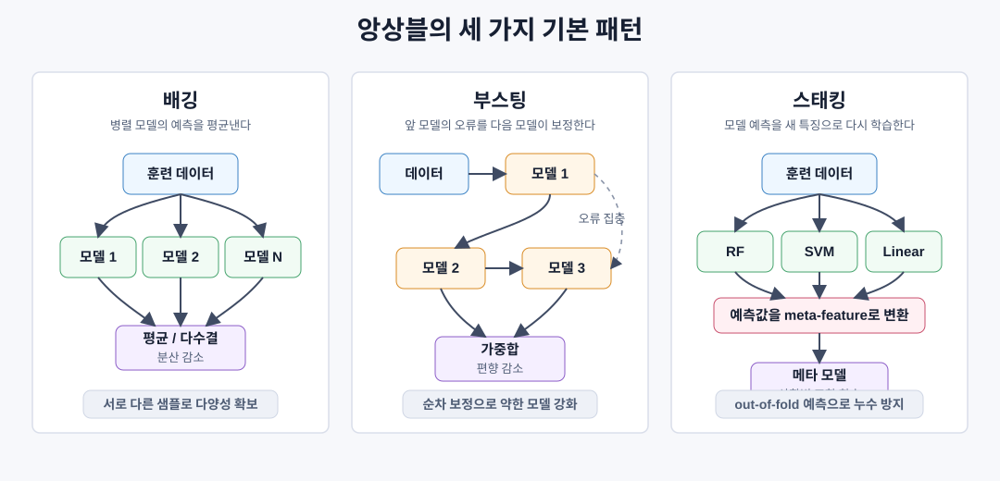
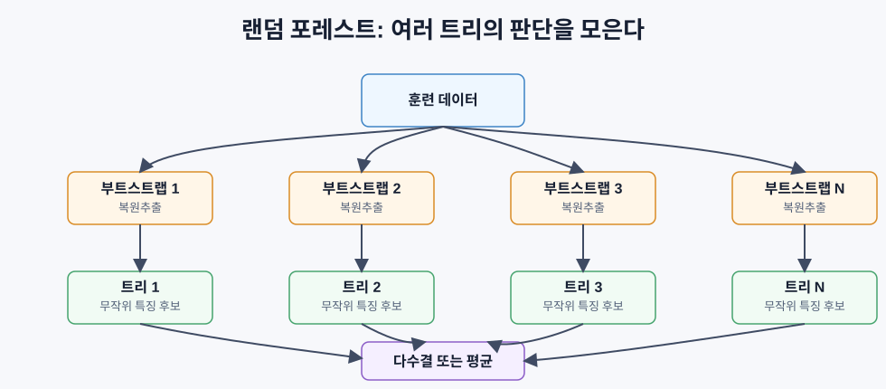

# 앙상블 방법

## 핵심 아이디어

앙상블은 여러 모델의 예측을 합쳐 하나의 최종 예측을 만드는 방법이다. 단일 모델이 너무 단순하면 편향이 크고, 너무 복잡하면 분산이 크다. 앙상블은 이 둘을 직접 다룬다.

```text
배깅 = 여러 모델을 병렬로 학습해 평균낸다 -> 주로 분산 감소
부스팅 = 모델을 순차적으로 쌓아 오류를 고친다 -> 주로 편향 감소
스태킹 = 여러 모델의 예측을 다시 학습한다 -> 상황별 모델 선택 학습
```



앙상블이 효과를 내려면 모델들이 다양해야 한다. 모든 모델이 같은 이유로 틀리면 투표를 해도 결과는 달라지지 않는다. 좋은 앙상블은 각 모델이 다른 데이터, 다른 특징, 다른 학습 순서, 다른 모델 구조를 보게 만든다.

## 왜 여러 모델을 합치면 좋아질까

각 분류기가 독립이고, 개별 정확도가 `p > 0.5`라면 다수결 정확도는 다음처럼 계산된다.

```text
P(majority correct)
= sum over k > N/2 of C(N, k) * p^k * (1 - p)^(N-k)
```

- `N`: 모델 개수
- `p`: 개별 모델의 정확도
- `k`: 정답을 맞힌 모델 수
- `C(N, k)`: N개 중 k개를 고르는 조합 수

예를 들어 60% 정확도의 모델 21개가 서로 독립적으로 실수한다면, 다수결 정확도는 약 74%까지 올라갈 수 있다. 101개라면 약 84%까지도 가능하다.

단, 현실의 모델들은 완전히 독립이 아니다. 그래서 앙상블의 진짜 질문은 “모델을 몇 개 만들까?”가 아니라 “모델들이 얼마나 서로 다른 실수를 하게 만들까?”이다.

| 다양성을 만드는 방법 | 대표 기법 | 의미 |
|---|---|---|
| 다른 데이터 부분집합 | 배깅 | 부트스트랩 샘플마다 모델을 따로 학습 |
| 다른 특징 부분집합 | 랜덤 포레스트 | 각 split에서 일부 특징만 후보로 사용 |
| 이전 오류에 집중 | 부스팅 | 앞 모델이 틀린 샘플 또는 잔차를 다음 모델이 학습 |
| 다른 모델 계열 | 스태킹 | 트리, 선형 모델, SVM 등의 예측을 다시 조합 |

## 배깅

배깅은 Bootstrap Aggregating의 줄임말이다. 원본 훈련 데이터에서 복원추출로 여러 부트스트랩 샘플을 만들고, 각 샘플에 모델을 학습한 뒤 예측을 평균내거나 다수결로 합친다.

```text
훈련 데이터
  -> 부트스트랩 샘플 1 -> 모델 1
  -> 부트스트랩 샘플 2 -> 모델 2
  -> 부트스트랩 샘플 3 -> 모델 3
  -> ...
  -> 부트스트랩 샘플 N -> 모델 N

모델 1..N의 예측 -> 평균 또는 다수결 -> 최종 예측
```

부트스트랩 샘플은 원본 데이터와 같은 크기로 뽑지만, 복원추출이므로 어떤 샘플은 여러 번 들어가고 어떤 샘플은 빠진다. 한 부트스트랩 샘플에는 평균적으로 원본 샘플의 약 63.2%가 적어도 한 번 포함된다.

```text
특정 샘플이 한 번도 뽑히지 않을 확률
= (1 - 1/N)^N
≈ e^-1
≈ 0.368

따라서 적어도 한 번 뽑힐 확률
≈ 1 - 0.368
≈ 0.632
```

빠진 약 36.8%의 샘플은 out-of-bag 샘플이라고 부른다. 이 샘플은 해당 모델을 학습할 때 사용되지 않았으므로, 별도 검증 세트처럼 쓸 수 있다.

## 배깅과 분산 감소

배깅은 주로 분산을 줄인다. 개별 모델이 훈련 데이터의 노이즈에 과하게 맞더라도, 각 모델이 보는 부트스트랩 샘플이 다르면 과적합 방향도 달라진다. 평균을 내면 이 흔들림이 일부 상쇄된다.

모델들이 독립이고 각 모델의 분산이 `sigma^2`라면, 평균 예측의 분산은 다음처럼 줄어든다.

```text
Variance(mean of N independent models) = sigma^2 / N
```

하지만 모델들이 서로 상관되어 있으면 감소폭은 작아진다.

```text
평균 예측의 분산
= rho * sigma^2 + (1 - rho) * sigma^2 / N
```

- `rho`: 모델 예측 오차 사이의 상관
- `rho`가 낮을수록 앙상블 효과가 커짐
- `rho`가 1이면 모델들이 같은 실수를 하므로 평균내도 이득이 거의 없음

그래서 배깅에서는 모델 수뿐 아니라 모델 간 상관을 낮추는 것이 중요하다.

## 랜덤 포레스트

랜덤 포레스트는 배깅에 특징 무작위성을 추가한 방법이다. 여러 결정 트리를 부트스트랩 샘플에 학습시키고, 각 split에서 전체 특징이 아니라 무작위로 뽑은 일부 특징만 후보로 본다.



일반적인 후보 특징 수는 다음과 같다.

| 문제 | split마다 보는 특징 수 |
|---|---|
| 분류 | `sqrt(n_features)` |
| 회귀 | `n_features / 3` |

결정 트리는 단독으로 쓰면 분산이 큰 모델이다. 데이터가 조금만 바뀌어도 split 구조가 크게 달라질 수 있다. 랜덤 포레스트는 이런 고분산 트리를 많이 만들고 평균내서 안정화한다.

랜덤 포레스트의 장점:

- 스케일링이 크게 필요 없다.
- 비선형 관계와 특징 상호작용을 잘 잡는다.
- out-of-bag 평가를 사용할 수 있다.
- 특징 중요도를 얻을 수 있다.
- 기본값만으로도 꽤 강하다.

주의할 점:

- 단일 트리보다 해석이 어렵다.
- 트리들이 너무 비슷하면 앙상블 이득이 줄어든다.
- 데이터 밖으로 외삽하는 회귀 문제에는 약하다.

## 부스팅

부스팅은 모델을 순차적으로 학습한다. 새 모델은 앞 모델들이 잘 못 맞힌 부분에 집중한다. 최종 예측은 모든 모델의 가중합이다.

```text
초기 모델
  -> 오류 확인
  -> 오류가 큰 샘플 또는 잔차에 집중
  -> 다음 모델 학습
  -> 다시 오류 확인
  -> ...
  -> 모든 모델의 가중합
```

배깅이 “흔들리는 모델들을 평균내 안정화”하는 느낌이라면, 부스팅은 “부족한 모델을 계속 보정해 표현력을 키우는” 느낌에 가깝다.

| 비교 | 배깅 | 부스팅 |
|---|---|---|
| 학습 방식 | 병렬 | 순차 |
| 주된 효과 | 분산 감소 | 편향 감소 |
| 대표 모델 | 랜덤 포레스트 | AdaBoost, Gradient Boosting, XGBoost |
| 약점 | 편향이 큰 모델에는 한계 | 노이즈와 이상치에 민감할 수 있음 |
| 과적합 제어 | 모델 수, 특징 샘플링 | 학습률, 트리 깊이, 조기 종료 |

## AdaBoost

AdaBoost는 Adaptive Boosting의 줄임말이다. 보통 깊이 1짜리 결정 트리인 decision stump를 약한 학습기로 사용한다.

핵심은 샘플 가중치다. 처음에는 모든 샘플의 가중치가 같다. 어떤 모델이 샘플을 틀리면 그 샘플의 가중치를 올려 다음 모델이 더 신경 쓰게 만든다.

```text
1. 모든 샘플 가중치 초기화:
   w_i = 1 / N

2. t = 1..T 반복:
   a. 가중치가 있는 데이터로 약한 학습기 h_t 학습
   b. 가중 오류 계산:
      err_t = sum(w_i * I(h_t(x_i) != y_i)) / sum(w_i)
   c. 모델 가중치 계산:
      alpha_t = 0.5 * ln((1 - err_t) / err_t)
   d. 샘플 가중치 업데이트:
      w_i = w_i * exp(-alpha_t * y_i * h_t(x_i))
   e. w_i가 합 1이 되도록 정규화

3. 최종 예측:
   H(x) = sign(sum(alpha_t * h_t(x)))
```

`err_t`가 낮은 모델은 `alpha_t`가 커진다. 즉 잘 맞힌 모델일수록 최종 투표에서 더 큰 영향력을 가진다.

샘플 가중치 업데이트는 다음 의미를 갖는다.

| 경우 | `y_i * h_t(x_i)` | 가중치 변화 |
|---|---:|---|
| 맞힘 | `+1` | `exp(-alpha_t)`만큼 감소 |
| 틀림 | `-1` | `exp(alpha_t)`만큼 증가 |

AdaBoost는 깨끗한 데이터에서 강하지만, 이상치나 라벨 노이즈가 많으면 위험하다. 틀린 샘플에 계속 집중하기 때문에, 실제로는 노이즈인 샘플을 과하게 따라갈 수 있다.

## Gradient Boosting

Gradient Boosting은 부스팅을 임의의 손실 함수로 일반화한 방법이다. 새 모델은 “앞 모델의 오류”를 학습한다. 더 정확히는 현재 손실 함수의 음의 그래디언트, 즉 pseudo-residual을 학습한다.

```text
1. 초기 예측:
   F_0(x) = argmin_c sum L(y_i, c)

2. t = 1..T 반복:
   a. pseudo-residual 계산:
      r_i = -dL(y_i, F_{t-1}(x_i)) / dF_{t-1}(x_i)
   b. 새 트리 h_t를 r_i에 맞게 학습
   c. 최적 step size 계산:
      gamma_t = argmin_gamma sum L(y_i, F_{t-1}(x_i) + gamma * h_t(x_i))
   d. 예측 함수 업데이트:
      F_t(x) = F_{t-1}(x) + learning_rate * gamma_t * h_t(x)

3. 최종 예측:
   F_T(x)
```

제곱오차에서는 pseudo-residual이 실제 잔차와 같다.

```text
L(y, F(x)) = (y - F(x))^2
r_i = y_i - F_{t-1}(x_i)
```

그래서 회귀용 Gradient Boosting은 “현재 예측에서 남은 잔차를 다음 트리가 맞힌다”라고 이해해도 된다.

## 학습률과 트리 수의 관계

Gradient Boosting에서 학습률은 각 트리의 기여도를 줄이는 shrinkage 역할을 한다.

```text
F_t(x) = F_{t-1}(x) + eta * h_t(x)
```

- `eta`가 작으면 한 번에 조금씩 보정한다.
- 작은 `eta`는 보통 일반화에 유리하지만 더 많은 트리가 필요하다.
- 큰 `eta`는 빠르게 맞추지만 과적합이나 불안정성이 커질 수 있다.

| 설정 | 효과 | 위험 |
|---|---|---|
| 낮은 학습률 + 많은 트리 | 부드럽고 안정적인 개선 | 학습 비용 증가 |
| 높은 학습률 + 적은 트리 | 빠른 수렴 | 과적합 또는 발산 |
| 깊은 트리 | 복잡한 상호작용 포착 | 분산 증가 |
| 얕은 트리 | 안정적, 해석 쉬움 | 복잡한 패턴 부족 |

부스팅에서는 `learning_rate`, `n_estimators`, `max_depth`를 따로 생각하면 안 된다. 낮은 학습률은 더 많은 트리를 필요로 하고, 깊은 트리는 더 쉽게 과적합된다.

## XGBoost

XGBoost는 Gradient Boosting을 실무에 강하게 만든 구현이다. 단순히 “빠른 Gradient Boosting”이 아니라, 정규화와 최적화, 시스템 구현이 함께 들어간 모델이다.

주요 아이디어:

| 기능 | 의미 |
|---|---|
| L1/L2 정규화 | leaf weight가 과하게 커지는 것을 막음 |
| 2차 근사 | 손실의 1차/2차 미분을 사용해 split 품질 평가 |
| 결측치 처리 | 결측값을 어느 방향으로 보낼지 학습 |
| 열 부분 샘플링 | 특징 일부만 사용해 다양성과 일반화 개선 |
| 분위수 스케치 | 연속형 split 후보를 효율적으로 찾음 |
| 캐시 친화적 구조 | CPU 캐시 친화적인 데이터 배치로 속도 개선 |

정형 데이터에서는 XGBoost나 LightGBM 같은 gradient boosting 계열이 매우 강하다. 행과 열로 된 표 데이터라면, 신경망보다 먼저 강력한 부스팅 모델을 기준선으로 세우는 것이 보통 좋다.

## 스태킹

스태킹은 여러 base model의 예측을 다시 입력 특징으로 사용해 meta-learner를 학습하는 방법이다.

```text
원본 데이터
  -> 모델 A 예측
  -> 모델 B 예측
  -> 모델 C 예측

[A 예측, B 예측, C 예측] -> 메타 모델 -> 최종 예측
```

메타 모델은 어느 모델을 언제 믿을지 배운다. 예를 들어 어떤 영역에서는 랜덤 포레스트가 강하고, 다른 영역에서는 SVM이 강하다면, 스태킹은 그 차이를 학습할 수 있다.

가장 중요한 주의점은 데이터 누수다. base model을 훈련 데이터 전체에 학습한 뒤 같은 데이터에 대해 예측값을 만들면, 메타 모델은 과하게 낙관적인 정보를 보게 된다.

올바른 방식은 교차검증으로 out-of-fold 예측을 만드는 것이다.

```text
1. 훈련 데이터를 K개 fold로 나눈다.
2. K-1개 fold로 base model을 학습한다.
3. 남은 1개 fold에 대한 예측을 저장한다.
4. 모든 fold에 대해 반복하면 전체 훈련 데이터의 out-of-fold 예측이 생긴다.
5. 이 예측들을 meta-feature로 사용해 메타 모델을 학습한다.
```

스태킹은 마지막 1~2% 성능을 짜낼 때 유용하지만, 구조가 복잡하고 검증이 까다롭다.

## Voting

Voting은 가장 단순한 앙상블이다.

| 방식 | 의미 | 특징 |
|---|---|---|
| Hard voting | 클래스 라벨 다수결 | 단순하지만 확신 정도를 버림 |
| Soft voting | 클래스 확률 평균 | 확률 보정이 괜찮다면 보통 더 좋음 |

Soft voting은 각 모델의 예측 확률을 평균내고, 평균 확률이 가장 큰 클래스를 선택한다. 모델들의 확률이 잘 보정되어 있다면 hard voting보다 정보 손실이 적다.

## 방법별 선택 기준

| 방법 | 주로 줄이는 것 | 좋은 상황 | 주의할 점 |
|---|---|---|---|
| 배깅 | 분산 | 노이즈가 있고 고분산 모델을 쓸 때 | 편향이 큰 모델에는 한계 |
| 랜덤 포레스트 | 분산 | 정형 데이터 기준선, 많은 특징 | 단일 트리보다 해석 어려움 |
| AdaBoost | 편향 | 비교적 깨끗한 데이터, 약한 학습기 | 이상치와 라벨 노이즈에 민감 |
| Gradient Boosting | 편향 | 정형 데이터, 높은 정확도 필요 | 튜닝 없이 많이 쌓으면 과적합 |
| XGBoost/LightGBM | 편향과 분산 | 실무 정형 데이터 | 하이퍼파라미터가 많음 |
| 스태킹 | 둘 다 | 다양한 모델이 이미 있을 때 | 데이터 누수 위험 |
| Voting | 분산 | 빠르게 여러 모델을 합칠 때 | 모델 다양성이 없으면 효과 없음 |

## 실무에서의 기본 순서

정형 데이터 예측 문제라면 보통 다음 순서가 좋다.

```text
1. 단순 기준선 모델을 만든다.
2. 랜덤 포레스트로 안정적인 비선형 기준선을 만든다.
3. LightGBM 또는 XGBoost를 기본값으로 학습한다.
4. learning_rate, n_estimators, max_depth, regularization을 튜닝한다.
5. 마지막 성능이 더 필요할 때만 스태킹을 고려한다.
6. 모든 비교는 교차검증으로 확인한다.
```

신경망은 이미지, 텍스트, 음성처럼 비정형 데이터에서 강하다. 하지만 일반적인 표 데이터에서는 잘 튜닝된 gradient boosting이 더 빠르고 강한 경우가 많다.

## 자주 하는 실수

| 실수 | 왜 문제인가 | 해결 |
|---|---|---|
| 다양성 없는 모델을 많이 합침 | 같은 실수를 반복하므로 앙상블 이득이 작음 | 데이터/특징/모델 계열을 다르게 함 |
| 부스팅을 너무 오래 학습 | 노이즈까지 계속 보정 | 조기 종료와 검증 곡선 사용 |
| AdaBoost를 노이즈 많은 데이터에 사용 | 틀린 샘플 가중치가 계속 커짐 | 로버스트한 모델 또는 정규화 사용 |
| 스태킹에서 같은 데이터로 예측 생성 | 메타 모델에 데이터 누수 발생 | out-of-fold 예측 사용 |
| 단일 검증 점수만 보고 선택 | 우연한 split에 과적합 가능 | K-fold 교차검증 사용 |

## 핵심 정리

앙상블은 단일 모델의 약점을 여러 모델의 조합으로 보완한다.

```text
고분산 문제:
랜덤 포레스트, 배깅, voting처럼 평균으로 흔들림을 줄인다.

고편향 문제:
부스팅처럼 순차적으로 오류를 보정해 표현력을 키운다.

최종 성능을 더 끌어올리고 싶을 때:
스태킹으로 모델별 강점을 다시 학습한다.
```

가장 중요한 원칙은 다양성이다. 앙상블은 모델 수가 많아서 강한 것이 아니라, 서로 다른 관점에서 실수하기 때문에 강하다.
