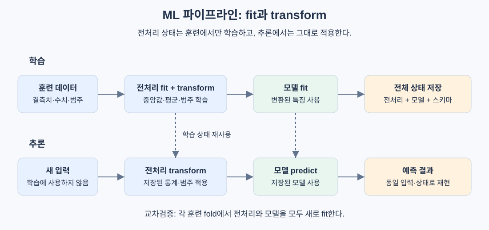

# ML 파이프라인

> 모델의 가중치만 저장하면 예측을 재현할 수 없다. 원본 데이터를 예측으로 바꾸는 전 과정을 함께 저장해야 한다.

## 핵심 아이디어

파이프라인은 여러 전처리 단계와 마지막 모델을 하나의 객체로 묶은 것이다. 결측치 대체, 수치형 표준화, 범주형 인코딩, 특징 생성, 모델 학습이 정해진 순서로 실행된다.

모델 정확도가 같아도, 훈련과 서비스에서 서로 다른 평균으로 표준화하면 결과는 달라진다. 그래서 배포 단위는 모델 하나보다 **학습된 전처리 상태를 포함한 파이프라인 전체**여야 한다.



| 파이프라인이 관리하는 것 | 예 |
|---|---|
| 처리 순서 | 결측치 대체 후 표준화 |
| 학습된 상태 | 중앙값, 평균, 표준편차, 범주 목록 |
| 입력과 출력의 계약 | 컬럼 이름, 순서, 타입, 출력 특징 수 |
| 최종 예측기 | 선형 모델의 가중치, 결정 트리 |

핵심은 단순히 함수를 순서대로 호출하는 것이 아니다. **데이터로부터 배우는 단계와 배운 값을 적용하는 단계를 분리**하는 것이다.

## fit과 transform의 차이

### fit: 훈련 데이터에서 상태를 배운다

표준화는 다음 식을 사용한다.

```text
mu_j = 훈련 데이터의 j번째 특징 평균
sigma_j = 훈련 데이터의 j번째 특징 표준편차
z_ij = (x_ij - mu_j) / sigma_j
```

`fit`은 `mu_j`, `sigma_j`를 계산해 저장한다. `transform`은 저장한 값으로 입력을 바꾼다. 검증·테스트·서비스 데이터에서 평균과 표준편차를 다시 구하면 훈련과 다른 좌표계를 사용하게 된다.

예를 들어 훈련 평균이 100, 표준편차가 20이면 새 입력 140은 항상 `(140 - 100) / 20 = 2`로 바뀌어야 한다. 함께 들어온 요청들의 평균으로 다시 표준화하면, 같은 140도 배치 구성에 따라 다른 값이 된다.

### 학습과 추론의 호출 순서

| 단계 | 학습 시 | 추론 시 |
|---|---|---|
| 결측치 대체 | 훈련 중앙값 계산 후 대체 | 저장한 중앙값으로 대체 |
| 표준화 | 훈련 평균·표준편차 계산 후 변환 | 저장한 통계로 변환 |
| 인코딩 | 훈련 범주 목록을 만들고 변환 | 같은 범주 순서로 변환 |
| 모델 | 변환된 특징으로 `fit` | 변환된 특징으로 `predict` |

`fit_transform(X_train)`은 `fit(X_train).transform(X_train)`을 묶은 편의 동작이다. 테스트에서는 `transform(X_test)`만 호출한다.

## 데이터 누수는 왜 생기는가

데이터 누수는 실제 예측 시점에 알 수 없는 정보가 학습에 들어가는 현상이다. 정답을 직접 입력하는 경우뿐 아니라, 테스트 분포를 전처리에 미리 반영하는 경우도 포함한다.

```text
잘못된 순서:
전체 데이터로 평균·표준편차 계산 -> 변환 -> 훈련/테스트 분리

올바른 순서:
훈련/테스트 분리 -> 훈련으로만 통계 계산 -> 양쪽에 같은 통계 적용
```

전체 데이터의 평균에는 테스트 샘플의 정보가 들어 있다. 누수로 점수가 얼마나 달라질지는 데이터에 따라 다르지만, 평가 대상의 정보를 미리 사용했다는 사실만으로 평가 설계가 잘못된다.

### 교차검증에서는 fold마다 다시 학습한다

전체 훈련 데이터로 scaler를 한 번 학습한 뒤 K-fold CV를 하면, 각 검증 fold의 통계가 다른 fold의 훈련 과정에 들어간다.

```text
각 fold마다:
1. 학습되지 않은 새 파이프라인을 만든다.
2. 해당 훈련 fold로 전처리와 모델을 fit한다.
3. 검증 fold는 transform과 predict만 한다.
4. 점수를 기록한다.
```

중앙값 대체, 특징 선택, PCA, 텍스트 어휘 사전·IDF 학습도 같은 원칙을 따른다. 모델만 새로 만드는 것으로는 충분하지 않다.

단, 파이프라인이 모든 누수를 자동으로 막아주지는 않는다. 미래 매출로 만든 컬럼, 같은 사람의 기록이 양쪽에 들어간 분할, 잘못된 타깃 인코딩은 별도의 검증 설계가 필요하다.

## 수치형과 범주형은 다르게 처리한다

### 컬럼별 전처리

실제 테이블에는 나이·소득 같은 수치형과 도시·요금제 같은 범주형이 섞여 있다. 모든 컬럼에 표준화를 적용할 수는 없다.

| 입력 묶음 | 처리 경로 | 결과 |
|---|---|---|
| 나이, 소득, 점수 | 중앙값 대체 후 표준화 | 수치형 특징 3개 |
| 도시, 요금제 | 최빈값 대체 후 one-hot encoding | 학습된 범주 수에 따른 이진 특징 |

컬럼별로 다른 변환을 적용한 뒤 결과를 가로로 결합하는 구조가 `ColumnTransformer`의 핵심이다. 컬럼 순서와 최종 특징 이름도 함께 관리해야 한다.

### 처음 보는 범주

훈련에 `서울`, `부산`만 있었는데 서비스에 `대전`이 들어올 수 있다.

```text
훈련 범주 순서: [서울, 부산]
서울 -> [1, 0]
부산 -> [0, 1]
대전 -> [0, 0]  # 알 수 없는 범주를 무시하는 정책의 예
```

전부 0으로 바꾸면 오류는 피할 수 있지만, 모델이 대전의 특성을 학습한 것은 아니다. 별도 `unknown` 범주를 둘지, 새 범주 비율이 커지면 재학습할지까지 정해야 한다. 결측치와 미지 범주를 같은 의미로 취급해도 되는지도 확인한다.

## 직접 구현: 상태를 가진 변환기와 파이프라인

다음 코드는 수치형 표준화와 단계 연결의 최소 구조다. 결측치 대체는 앞 단계에서 끝났다고 가정한다.

```python
import numpy as np


class Standardizer:
    def fit(self, X):
        self.mean_ = np.mean(X, axis=0)
        std = np.std(X, axis=0)
        self.scale_ = np.where(std == 0, 1.0, std)
        return self

    def transform(self, X):
        return (X - self.mean_) / self.scale_

    def fit_transform(self, X):
        return self.fit(X).transform(X)


class Pipeline:
    def __init__(self, steps):
        self.steps = steps

    def fit(self, X, y):
        current = X.copy()
        for _, step in self.steps[:-1]:
            current = step.fit_transform(current)
        self.steps[-1][1].fit(current, y)
        return self

    def predict(self, X):
        current = X.copy()
        for _, step in self.steps[:-1]:
            current = step.transform(current)
        return self.steps[-1][1].predict(current)
```

표준편차가 0인 컬럼은 1로 대체해 0으로 나누지 않도록 한다. 실제 변환기에는 입력 차원 검사, 학습 전 호출 검사, 전부 결측치인 컬럼의 처리 정책도 필요하다.

이 구조를 이해하면 라이브러리 파이프라인도 같은 방식으로 읽을 수 있다. 중간 단계는 변환기이고 마지막 단계는 예측기다. 파라미터 탐색 역시 모델 하나가 아니라 전처리와 모델의 조합 전체를 대상으로 한다.

## 재현성은 seed 하나로 완성되지 않는다

| 고정·기록할 것 | 이유 |
|---|---|
| 코드 버전 | 같은 설정이어도 코드가 바뀌면 결과가 달라짐 |
| 데이터 버전과 분할 | 샘플 추가, 라벨 수정, 분할 변경을 구분 |
| 하이퍼파라미터 | 실험의 조건을 복원 |
| 난수 seed | 분할·초기화·샘플링의 무작위성 통제 |
| 실행 환경 | 언어·패키지·하드웨어 차이 추적 |
| 학습된 전체 상태 | 추론에서 재학습 없이 같은 변환 수행 |

GPU 연산, 병렬 계산 순서, 라이브러리 버전 차이 때문에 seed만 같다고 항상 비트 단위로 동일하지는 않다. 필요한 재현 수준이 예측 일치인지, 허용 오차 내 수치 일치인지도 정한다.

## 실험 추적, 모델 등록, 데이터 버전 관리

세 가지는 역할이 다르다.

| 기능 | 답하려는 질문 | 기록 예 |
|---|---|---|
| 실험 추적 | 어떤 조건에서 어떤 점수가 나왔는가? | 설정, 지표, 실행 시간, 아티팩트 |
| 모델 등록 | 어떤 버전을 배포하고 되돌릴 것인가? | 모델 버전, 검증 결과, 배포 이력 |
| 데이터 버전 관리 | 정확히 어떤 데이터로 학습했는가? | 데이터 해시, 저장 위치, 분할 정보 |

원문은 MLflow·wandb·DVC를 예로 든다. 여기서는 역할을 이해하고, 저장소의 의존성 원칙에 맞춰 실습은 JSON 설정·로그와 파일 해시로 시작할 수 있다. 외부 패키지 설치 예시는 생략한다: **stays stdlib-first for educational clarity.**

```json
{
  "run_id": "pipeline-001",
  "seed": 42,
  "code_revision": "<commit>",
  "data_sha256": "<hash>",
  "split_version": "v1",
  "config": {"imputation": "median", "learning_rate": 0.01},
  "validation_metrics": {"f1": 0.82},
  "artifact": "artifacts/pipeline-001"
}
```

여러 실험을 비교할 때는 검증 지표를 사용하고, 최종 테스트는 설정을 확정한 뒤 평가한다. 테스트 점수를 반복해서 보고 가장 좋은 실행을 고르면 테스트도 튜닝에 사용한 셈이다.

## 직렬화와 배포

저장할 것은 모델 가중치뿐 아니라 전처리 통계, 범주 목록, 컬럼 스키마, 설정이다. 예측에 필요한 상태를 하나의 버전으로 묶는다.

배포 전 확인 순서:

1. 파이프라인을 훈련 데이터에 학습한다.
2. 고정된 입력에 대한 예측을 기록한다.
3. 학습된 상태 전체를 저장한다.
4. 별도 프로세스에서 불러온다.
5. 같은 입력의 특징·예측이 허용 오차 안에서 같은지 비교한다.

Python 객체 직렬화는 편리하지만, pickle 계열 파일은 신뢰할 수 있는 출처에서만 읽어야 한다. 단순한 모델이라면 JSON으로 메타데이터를, NumPy 파일로 배열을 저장하고 구조를 검증하는 방식도 가능하다.

## 노트북에서 운영 가능한 구조로 옮기기

| 순서 | 작업 | 확인할 것 |
|---|---|---|
| 1 | 탐색 코드를 함수와 변환기로 분리 | 숨은 전역 변수 제거 |
| 2 | 모든 변환을 파이프라인에 포함 | 훈련·서비스 처리 일치 |
| 3 | 설정을 외부 파일로 이동 | 재실행 조건 기록 |
| 4 | 입력 스키마 검증 | 누락 컬럼, 단위, 타입, 범주 변화 |
| 5 | 실험과 데이터 버전 기록 | 실행 결과의 출처 추적 |
| 6 | 저장·복원 후 예측 비교 | 배포 아티팩트의 완전성 |
| 7 | 운영 입력·성능 모니터링 | 데이터 변화와 재학습 시점 |

단위가 원에서 달러로 바뀌어도 컬럼 타입은 숫자다. 따라서 스키마 검사만으로는 부족하며, 값의 범위와 분포도 함께 살펴야 한다.

## 자주 하는 실수

| 실수 | 결과 | 수정 |
|---|---|---|
| 분할 전에 전처리 fit | 평가 데이터 정보 유입 | 먼저 분할하고 훈련으로만 fit |
| CV 밖에서 특징 선택 | 검증 정답이 특징 선택에 영향 | fold 내부에서 선택 |
| 추론 때 fit_transform | 요청마다 좌표계 변경 | 저장된 transform만 사용 |
| 가중치만 저장 | 전처리 상태 복원 불가 | 전체 파이프라인 저장 |
| 새 범주를 무조건 무시 | 입력 분포 변화 은폐 | 미지 범주 비율 모니터링 |
| 동일 seed만 믿음 | 데이터·환경 차이 누락 | 코드·데이터·환경 함께 기록 |
