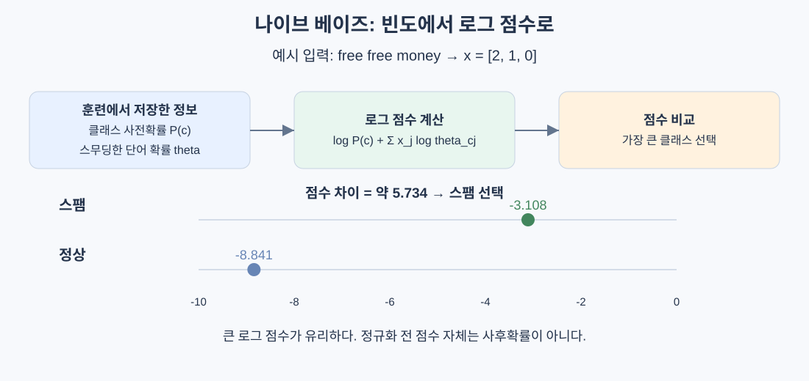

# 나이브 베이즈

> 특징들이 클래스 안에서 독립이라고 가정한다. 가정이 현실과 달라도, 적은 데이터로 유용한 분류기를 만들 수 있다.

## 핵심 아이디어

나이브 베이즈(Naive Bayes)는 베이즈 정리로 입력의 클래스를 추론하는 생성 모델이다. 클래스별로 어떤 특징이 자주 나타나는지 학습한 뒤, 새 입력이 각 클래스에서 얼마나 그럴듯한지 비교한다.

스팸 메일에는 `free`, `money`가 자주 나오고 정상 메일에는 `meeting`이 자주 나온다면, 이 빈도만으로도 새 메일을 분류할 수 있다. 무수한 단어 조합을 모두 외우는 대신 각 단어의 통계를 모으는 것이다.



장점은 단순한 학습, 적은 데이터에서의 안정성, 희소한 고차원 입력 처리다. 단점은 특징 간 의존성을 충분히 표현하지 못하고, 출력 확률이 과도하게 확신하는 값이 되기 쉽다는 것이다.

## 베이즈 정리로 분류하기

```text
P(c | x) = P(x | c) P(c) / P(x)
```

| 기호 | 이름 | 의미 |
|---|---|---|
| P(c) | 사전확률, prior | 입력을 보기 전 클래스의 빈도 |
| P(x \| c) | 우도, likelihood | 클래스 c에서 이런 입력이 나올 가능성 |
| P(c \| x) | 사후확률, posterior | 입력을 본 뒤 클래스 c일 확률 |
| P(x) | 증거, evidence | 모든 클래스에 걸친 입력의 확률 |

같은 입력 `x`의 클래스를 비교할 때 `P(x)`는 공통이다. 따라서 분류에는 다음 비교만 필요하다.

```text
predicted_class = argmax_c P(c) P(x | c)
```

중요한 구분은 `P(x | c)`와 `P(c | x)`가 다르다는 점이다. 스팸에 `free`가 자주 나온다는 사실만으로, `free`가 있는 모든 메일이 스팸인 것은 아니다. 스팸 자체의 빈도도 함께 고려해야 한다.

## naive 가정: 클래스가 주어지면 특징은 독립이다

### 왜 가정이 필요한가

단어 존재 여부를 특징으로 삼으면 어휘 V개에 가능한 조합이 `2^V`개다. 조합별 확률을 직접 추정하기에는 데이터가 턱없이 부족하다.

나이브 베이즈는 결합확률을 다음처럼 분해한다.

```text
P(x_1, ..., x_d | c) ≈ product_j P(x_j | c)
```

이것은 **조건부 독립**이다. 모든 문서에서 단어들이 무조건 독립이라는 뜻이 아니라, 클래스를 고정했을 때 각 특징을 독립으로 모델링한다는 뜻이다. 실제 언어에서는 같은 클래스 안에서도 `machine`과 `learning`이 함께 나오므로 이 가정은 대체로 정확하지 않다.

### 틀린 가정이 왜 쓸모 있는가

- 추정할 통계가 줄어 적은 데이터에서도 안정적이다.
- 정확한 확률 전체를 맞추지 못해도, 정답 클래스의 점수가 가장 높을 수 있다.
- 빈도 집계로 학습하므로 최적화 반복이 필요하지 않다.

그러나 상관된 특징의 중복 계산이 항상 상쇄되는 것은 아니다. 특정 클래스의 증거만 과장하면 분류 순위까지 틀릴 수 있다. **분류가 잘된다는 사실과 확률이 정확하다는 사실은 별개**다.

## 다항 나이브 베이즈: 단어의 횟수 모델링

### 클래스별 단어 확률

다항 NB는 문서를 단어 개수 벡터로 표현한다.

```text
어휘: [free, money, meeting]
문서: "free free money"
x = [2, 1, 0]
```

클래스별 단어 확률은 다음처럼 계산한다.

```text
theta_cj = (N_cj + alpha) / (N_c + alpha V)

N_cj: 클래스 c의 모든 문서에서 단어 j가 나온 총횟수
N_c: 클래스 c의 전체 단어 횟수 = sum_j N_cj
V: 어휘 수
alpha: 스무딩 강도
```

사전확률 `P(c)`는 **문서 수 비율**로, 단어 확률은 **단어 횟수 비율**로 구한다. 두 분모를 혼동하면 안 된다.

### 로그 점수

다항분포의 조합 계수는 같은 문서를 비교할 때 클래스 간 공통이므로 분류 점수에서 생략할 수 있다.

```text
score_c(x) = log P(c) + sum_j x_j log theta_cj
prediction = argmax_c score_c(x)
```

단어가 두 번 나오면 로그 증거도 두 번 더한다. 나오지 않은 단어는 `x_j = 0`이므로 직접 기여하지 않는다.

## 계산 예시: free free money

원문과 같은 세 단어를 사용한다.

| 클래스 | free 횟수 | money 횟수 | meeting 횟수 | 전체 단어 수 | 사전확률 |
|---|---|---|---|---|---|
| 스팸 | 80 | 60 | 10 | 150 | 0.4 |
| 정상 | 5 | 10 | 100 | 115 | 0.6 |

`alpha = 1`, `V = 3`이면:

```text
P(free | 스팸) = 81 / 153 ≈ 0.5294
P(money | 스팸) = 61 / 153 ≈ 0.3987
P(meeting | 스팸) = 11 / 153 ≈ 0.0719

P(free | 정상) = 6 / 118 ≈ 0.0508
P(money | 정상) = 11 / 118 ≈ 0.0932
P(meeting | 정상) = 101 / 118 ≈ 0.8559
```

새 문서 `x = [2, 1, 0]`의 자연로그 점수는:

```text
score_스팸 = log(0.4) + 2 log(81/153) + log(61/153)
           ≈ -3.108

score_정상 = log(0.6) + 2 log(6/118) + log(11/118)
           ≈ -8.841
```

더 큰 점수인 스팸을 고른다. 음수끼리 비교할 때도 `-3.108 > -8.841`이다.

여기서 점수 자체를 `log P(c | x)`라고 부르면 엄밀하지 않다. 정규화 항을 생략했기 때문이다. 확률이 필요하면 클래스 전체에 대해 정규화한다.

```text
m = max_c score_c
P(c | x) = exp(score_c - m) / sum_k exp(score_k - m)
```

최댓값을 빼면 지수 계산이 안정적이다. 이 예시의 모델상 스팸 확률은 약 0.997이지만, 실제 스팸 빈도도 99.7%라는 보장은 없다.

## 라플라스 스무딩

어떤 단어가 특정 클래스에 한 번도 나오지 않았다면, 단순 빈도 추정은 확률을 0으로 만든다. 곱셈에서는 0 하나가 다른 모든 증거를 없앤다.

```text
스무딩 전: 0 / N_c = 0
스무딩 후: (0 + alpha) / (N_c + alpha V) > 0
```

| alpha 변화 | 의미 |
|---|---|
| 0에 가까움 | 관측 빈도를 강하게 신뢰 |
| 1 | 각 단어에 가상 관측 1개를 추가하는 Laplace smoothing |
| 커짐 | 클래스별 단어 분포가 균등분포 쪽으로 이동 |

분자만이 아니라 분모에도 `alpha V`를 더해야 확률 합이 1이 된다. 이는 대칭 Dirichlet 사전분포 아래의 사후 예측 확률로 이해할 수 있다.

다만 스무딩은 **어휘 사전에 있는 단어가 특정 클래스에서 0번 나온 문제**를 해결한다. 사전 자체에 없는 새 단어는 무시하거나 별도 unknown 토큰으로 처리하는 정책이 필요하다. 테스트 문서로 사전을 먼저 확장하면 누수가 생긴다.

## 로그 공간을 사용하는 이유

```text
0.01^200 = 10^-400
```

확률 수백 개를 곱하면 부동소수점 표현 범위 아래로 내려갈 수 있다. 로그를 사용하면 곱이 합으로 바뀌고, 로그는 단조증가하므로 최댓값의 위치도 보존된다.

행렬로 쓰면:

```text
X: n개 문서 × V개 단어
L: K개 클래스 × V개 단어의 로그 확률
b: K개 클래스의 로그 사전확률

scores = X @ L.T + b
```

예측 비용은 밀집 행렬 기준 `O(nVK)`다. 희소 입력에서는 0이 아닌 특징 위주로 계산해 저장 공간과 계산량을 줄일 수 있다.

## 세 변형 비교

| 변형 | 특징 표현 | 클래스별 학습 상태 | 주로 고려할 상황 |
|---|---|---|---|
| 다항 | 단어 횟수 등 비음수 값 | 단어 확률 | 문서·주제 분류 |
| 베르누이 | 존재 여부 0/1 | 등장 확률 | 짧은 텍스트, 이진 특징 |
| 가우시안 | 연속 측정값 | 특징별 평균·분산 | 클래스 안에서 정규분포에 가까운 수치형 |

### 베르누이: 부재도 증거다

```text
p_cj = (단어 j가 등장한 클래스 c의 문서 수 + alpha)
       / (클래스 c의 문서 수 + 2 alpha)

score_c = log P(c)
          + sum_j [x_j log p_cj + (1-x_j) log(1-p_cj)]
```

`free`가 없는 사실도 점수에 영향을 준다. 문서에서 `free`가 1번인지 10번인지는 구분하지 않는다. 모든 입력을 0/1로 바꾸는 것만으로 다항 NB가 베르누이 NB가 되는 것은 아니다. 부재 항까지 모델링해야 한다.

### 가우시안: 특징별 정규분포

```text
P(x_j | c) = exp(-(x_j-mu_cj)^2 / (2 var_cj))
             / sqrt(2 pi var_cj)
```

클래스와 특징마다 평균·분산을 구한다. 분산이 0이면 계산이 깨지므로 작은 양의 값을 더한다. 클래스별 분산이 다를 수 있어 가우시안 NB의 결정 경계가 항상 선형인 것은 아니다.

## 텍스트 파이프라인과 TF-IDF

1. 훈련 문서로 토큰화 규칙과 어휘 사전을 정한다.
2. 단어 개수 벡터를 만든다.
3. 필요하면 훈련 데이터로 IDF를 학습한다.
4. NB를 학습한다.
5. 검증 문서는 같은 사전·IDF로 변환한다.

TF-IDF는 흔한 단어의 영향력을 낮추는 비음수 가중치다. 다항 NB에 사용할 수 있지만, 정수 횟수에 대한 엄밀한 생성 모형과는 달라진다. 실제 효과는 검증해야 한다. 표준화로 음수가 된 입력은 다항 NB에 맞지 않으며, 단순히 양수로 이동시키는 것도 단어 횟수의 의미를 바꾼다.

원문의 scikit-learn 사용 예시는 나이브 베이즈 분류기를 제공한다. 저장소의 허용 목록에 없는 의존성을 추가하는 예제는 생략한다: **stays stdlib-first for educational clarity.**

## 로지스틱 회귀와 비교

| 관점 | 나이브 베이즈 | 로지스틱 회귀 |
|---|---|---|
| 학습 대상 | P(X \| Y), P(Y) | P(Y \| X) |
| 방법 | 클래스별 통계 추정 | 분류 손실 최소화 |
| 학습 비용 | 주로 빈도 집계 | 반복 최적화 |
| 적은 데이터 | 강한 가정이 분산을 줄일 수 있음 | 정규화와 데이터 양이 중요 |
| 특징 의존성 | 독립 가정으로 중복 계산 가능 | 독립 가정 없이 가중치 공동 학습 |
| 확률 | 과도한 확신에 주의 | 별도 보정이 필요할 수도 있음 |

데이터가 적으면 NB가, 많으면 로지스틱 회귀가 무조건 이긴다는 법칙은 아니다. 같은 분할·특징으로 비교해야 한다. 확률을 비용 계산이나 임계값 판단에 쓰려면 별도 검증 데이터 또는 교차검증으로 확률 보정도 확인한다.

## 자주 하는 실수

| 실수 | 바로잡기 |
|---|---|
| 전체 문서로 사전·IDF 학습 | 훈련 fold 안에서만 학습 |
| 로그 점수를 정규화된 로그 확률로 간주 | 클래스별 정규화 항 추가 |
| alpha를 분자에만 더함 | 분모에도 alpha V 추가 |
| 문서 수와 단어 수 혼동 | 사전확률과 단어 확률의 분모 구분 |
| NB 확률을 실제 빈도로 믿음 | 보정 상태를 따로 평가 |
| 연관된 특징은 항상 상쇄된다고 생각 | 중복 증거가 순위를 바꿀 수도 있음 |
