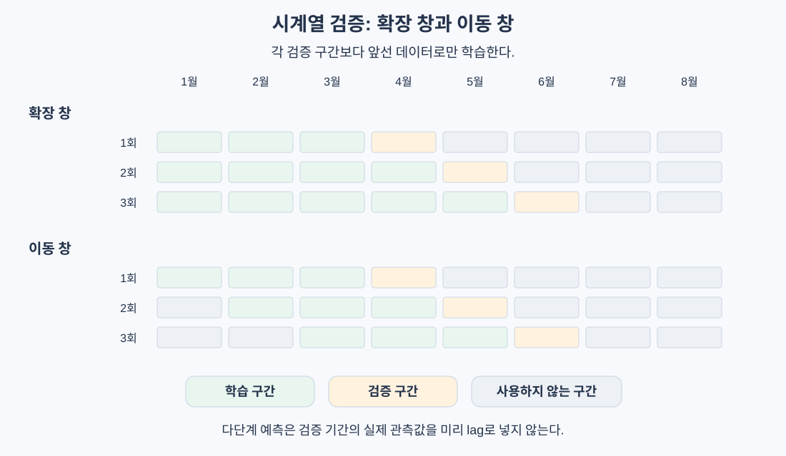

# 시계열 기초

> 미래를 예측하는 모델은 과거 정보만으로 평가해야 한다. 시간 순서는 특징 설계와 검증 모두의 제약이다.

## 핵심 아이디어

시계열은 시간 순서가 있는 관측값이다. 일별 매출, 시간별 온도, 분당 CPU 사용률처럼 현재 값이 과거 값과 연결된다.

일반적인 무작위 분할을 적용하면 미래의 패턴을 배운 모델로 과거를 평가할 수 있다. 실제 배포에서는 불가능한 정보 흐름이다. 따라서 시계열의 첫 과제는 모델 선택보다 **예측 시점에 무엇을 알 수 있는지 정하는 것**이다.



| 일반적인 독립 표본 문제 | 시계열 예측 문제 |
|---|---|
| 샘플 순서가 중요하지 않을 수 있음 | 순서가 정보이자 제약 |
| 무작위 분할을 사용할 수 있음 | 미래 예측에는 시간 기반 분할 필요 |
| 분포가 일정하다고 가정하기 쉬움 | 추세·계절성·구조 변화 고려 |
| 특징이 이미 표 형태로 주어짐 | 과거 값으로 특징을 직접 구성 |

모든 시계열이 비정상적인 것은 아니다. 정상 시계열도 자기상관을 가질 수 있다. **독립성**과 **정상성**은 서로 다른 개념이다.

## 추세, 계절성, 잔차

시계열의 변동을 나누면 무엇을 예측할 수 있는지 이해하기 쉽다.

```text
가법 모형: y_t = T_t + S_t + R_t
승법 모형: y_t = T_t × S_t × R_t

T_t: 추세, 장기적인 증가·감소
S_t: 계절성, 일정 주기로 반복되는 패턴
R_t: 잔차, 추세와 계절성을 제거한 나머지
```

| 성분 | 매출 예시 | 살펴볼 것 |
|---|---|---|
| 추세 | 고객 증가로 기본 매출 상승 | 수준 변화, 성장률 |
| 계절성 | 주말·연말마다 증가 | 일·주·연 단위 주기 |
| 잔차 | 행사, 장애, 예측 불가능한 변동 | 남은 자기상관, 이상치 |

매출 수준이 커질수록 계절 변동 폭도 커지면 승법 구조를 생각할 수 있다. 양수 데이터에 로그를 취하면 곱셈 구조를 덧셈 구조로 바꿀 수 있다. 단, 로그 예측을 지수로 되돌린 값이 원래 척도의 평균 예측과 자동으로 같아지지는 않는다.

잔차에 뚜렷한 주기가 남아 있다면 모델이 설명하지 못한 정보가 있다는 신호다. 반대로 잡음에 가까운 잔차까지 반드시 예측할 수 있는 것은 아니다.

## 정상성: 통계적 관계가 시간에 따라 유지되는가

### 약한 정상성

이 강의에서 주로 다루는 정상성은 평균·분산·공분산에 대한 조건이다.

```text
E[y_t] = mu                         # 일정한 평균
Var(y_t) = sigma^2                  # 일정한 유한 분산
Cov(y_t, y_(t-k)) = gamma(k)         # 시점이 아니라 간격 k에만 의존
```

이동 평균과 이동 표준편차를 그려 크게 달라지는지 보면 실마리를 얻을 수 있다. 하지만 유한한 표본의 통계는 원래 흔들리므로, 그래프가 평평하지 않다고 바로 비정상이라고 확정할 수는 없다.

### 차분

차분은 수준 자체 대신 변화를 모델링한다.

```text
1차 차분: delta y_t = y_t - y_(t-1)
2차 차분: delta^2 y_t = delta y_t - delta y_(t-1)
계절 차분: y_t - y_(t-s)             # 주기 s
```

```text
원래 값:  [100, 102, 106, 112, 120]
1차 차분: [2, 4, 6, 8]
2차 차분: [2, 2, 2]
```

이는 다항 추세를 제거하는 간단한 예다. 모든 시계열을 두 번 차분하면 정상화된다는 뜻은 아니다. 과도한 차분은 잡음과 불필요한 자기상관을 만들 수 있다.

차분값을 예측했다면 원래 수준으로 복원해야 한다.

```text
1단계 예측: y_hat_(t+1) = y_t + delta_y_hat_(t+1)
h단계 예측: y_hat_(t+h) = y_t + sum_(j=1..h) delta_y_hat_(t+j)
```

### ADF 검정의 해석

원문은 정상성 확인 도구로 ADF 검정을 소개한다. 정확한 귀무가설은 **단위근이 존재한다**는 것이다. 작은 p값은 선택한 상수항·추세항 설정 아래에서 단위근 귀무가설을 기각하는 근거다.

단위근 기각이 모든 형태의 정상성을 증명하는 것은 아니다. 구조 변화나 시간에 따라 변하는 분산은 별도로 살펴야 한다. 이 정리의 직접 구현은 이동 통계와 차분을 중심으로 이해한다.

## 자기상관: 과거 어느 시점이 관련되는가

### ACF

ACF는 현재와 k시점 전 값의 상관을 나타낸다.

```text
rho(k) = Corr(y_t, y_(t-k))
```

주간 반복이 있는 일별 데이터라면 lag 7, 14 등에 봉우리가 생길 수 있다. 강한 추세도 ACF를 높일 수 있으므로 원시 ACF만 보고 관련 lag를 확정하지 않는다.

### PACF

PACF는 lag 1부터 k-1까지의 영향을 선형적으로 통제한 뒤, 현재와 lag k 사이에 남는 상관이다. ACF가 전체 관계를 본다면 PACF는 짧은 lag를 통한 간접 관계를 일부 제거한다.

ACF가 0이라고 모든 비선형 관계까지 없다는 뜻은 아니다. lag 선택은 ACF·PACF, 도메인 주기, 시간 기반 검증을 함께 사용한다.

## lag 특징으로 지도학습 문제 만들기

시계열 `[10, 12, 14, 13, 15]`에 lag 1과 2를 사용하면:

| 예측할 시점 | lag 2 | lag 1 | target |
|---|---|---|---|
| t=3 | 10 | 12 | 14 |
| t=4 | 12 | 14 | 13 |
| t=5 | 14 | 13 | 15 |

```text
X_t = [y_(t-1), y_(t-2), ..., y_(t-p)]
target_t = y_t
```

행 하나는 “과거 p개를 보고 다음 값을 예측하는 문제”다. 이렇게 만들면 선형 회귀나 트리 모델에도 입력할 수 있다.

### 이동 통계도 한 칸 뒤에서 끝나야 한다

```text
y_t를 예측할 때:
rolling_mean_t = mean(y_(t-w), ..., y_(t-1))
```

`y_t`까지 포함한 평균은 정답을 특징에 넣은 것이다. 중심 이동 평균처럼 미래를 포함하는 계산도 예측용 특징에 그대로 쓸 수 없다.

| 특징 | 사용 가능한 조건 |
|---|---|
| 전날 매출 | 예측 시 전날 집계가 완료되어 있음 |
| 과거 7일 평균 | 창이 예측 시점 이전에서 끝남 |
| 예측일의 요일·공휴일 | 사전에 알 수 있는 달력 정보 |
| 예측일의 실제 기온 | 사전 예측에서는 사용 불가 |
| 예측 시점에 발표된 기온 예보 | 해당 시점의 예보 버전을 보관했다면 가능 |

데이터의 관측 시점과 **실제로 이용 가능해진 시점**은 다를 수 있다. 늦게 확정되는 매출·수정된 통계도 주의한다.

## 직접 구현: lag와 이동 평균

```python
import numpy as np


def make_features(series, n_lags=2, window=3):
    values = np.asarray(series, dtype=float)
    if n_lags < 1 or window < 1:
        raise ValueError("lags and window must be positive")
    start = max(n_lags, window)
    if len(values) <= start:
        raise ValueError("not enough history")
    X, y = [], []
    for t in range(start, len(values)):
        lags = [values[t - lag] for lag in range(1, n_lags + 1)]
        past_mean = values[t - window:t].mean()
        X.append(lags + [past_mean])
        y.append(values[t])
    return np.array(X), np.array(y)
```

배열 슬라이스의 끝 `t`는 포함되지 않는다. 첫 몇 행은 과거가 부족하므로 버린다. 미래 값으로 빈칸을 채우면 안 된다.

## Walk-forward validation

### 확장 창과 이동 창

| 방식 | 학습 구간 | 특징 |
|---|---|---|
| Expanding window | 처음부터 현재까지 | 데이터를 더 많이 사용 |
| Sliding window | 최근 일정 길이 | 오래된 분포를 잊음 |

```text
확장 창 예시:
1회: 1~3월 학습, 4월 평가
2회: 1~4월 학습, 5월 평가
3회: 1~5월 학습, 6월 평가

이동 창 예시:
1회: 1~3월 학습, 4월 평가
2회: 2~4월 학습, 5월 평가
3회: 3~5월 학습, 6월 평가
```

각 fold마다 전처리와 모델을 새로 fit한다. 특징의 정규화 통계도 해당 훈련 구간에서만 구한다.

### 한 번에 여러 날 예측하는 평가의 함정

테스트 구간의 lag를 실제 관측값으로 만들어 한꺼번에 평가하면, 각 예측 시점에 직전 관측값을 새로 받는 **순차 1단계 예측**을 평가하는 셈이다.

4월 1일에 4월 전체를 한 번에 예측하는 문제에서는 4월 2일 이후의 실제 매출을 lag로 사용할 수 없다. 예측값으로 채우거나, horizon별 직접 모델을 사용해야 한다.

또한 목표가 미래 7일 매출 합계라면 훈련 마지막 행의 정답 기간이 검증 구간과 겹칠 수 있다. 이런 경우 gap을 두거나 겹치는 훈련 행을 제거한다. 무조건 같은 길이의 gap을 쓰기보다 정보가 사용되는 시점을 기준으로 정한다.

## AR과 ARIMA의 직관

### AR: 과거 값의 선형 결합

```text
y_t = b + phi_1 y_(t-1) + ... + phi_p y_(t-p) + epsilon_t
```

lag 특징에 선형 회귀를 적용한 것이 AR의 기본 형태다. 절편 열을 추가하고 최소제곱으로 계수를 구할 수 있다.

```python
X, y = make_features(series, n_lags=5, window=5)
X_lags = X[:, :5]
design = np.column_stack([np.ones(len(X_lags)), X_lags])
theta = np.linalg.lstsq(design, y, rcond=None)[0]
```

### ARIMA(p, d, q)

| 구성 | 뜻 | 사용하는 정보 |
|---|---|---|
| AR(p) | 자기회귀 | 과거 p개 값 |
| I(d) | 차분 | d회 차분한 시계열 |
| MA(q) | 이동평균 모형 | 과거 q개 예측 오차·충격 |

ARIMA의 MA는 최근 관측값을 평균내는 rolling mean과 다르다. 차분 시계열 `z_t`에 대해 다음처럼 표현한다.

```text
z_t = b + sum_i phi_i z_(t-i)
        + epsilon_t + sum_j theta_j epsilon_(t-j)
```

ARIMA 전체의 추정은 이 강의의 직접 구현 범위 밖이다. 여기서는 과거 값, 차분, 과거 오차를 결합한다는 의미에 집중한다.

## 예측 기간에 따른 전략

| 전략 | 방법 | 장점 | 주의점 |
|---|---|---|---|
| Recursive | 1단계 예측을 다음 입력에 사용 | 모델 하나로 여러 단계 | 오차 누적, 학습·추론 입력 차이 |
| Direct | h별로 y_(t+h)를 예측하는 모델 | 이전 예측 오차가 입력으로 전파되지 않음 | 모델 수 증가, horizon 간 일관성 |
| Multi-output | 한 모델이 여러 미래 값을 출력 | 여러 horizon의 정보 공유 | 출력 구조를 지원해야 함 |

Direct도 오차가 없는 것은 아니다. 긴 horizon은 본질적으로 불확실하고, 미래 target이 필요해 사용 가능한 학습 행이 줄어든다.

## 평가 지표와 기준선

```text
MAE = mean(|y - y_hat|)
RMSE = sqrt(mean((y - y_hat)^2))
MAPE = 100 × mean(|(y - y_hat) / y|)
```

| 지표 | 해석 | 주의점 |
|---|---|---|
| MAE(평균 절대 오차) | 원래 단위의 평균 절대 오차 | 큰 오차의 추가 비용 반영이 약함 |
| RMSE(평균 제곱 오차의 제곱근) | 큰 오차에 더 민감 | 이상치 영향이 큼 |
| MAPE(평균 절대 백분율 오차) | 상대 오차 비율 | 실제 값 0에서 정의 불가, 0 근처에서 불안정 |

반드시 같은 예측 시점과 예측 기간으로 기준선과 비교한다.

- 지속성 기준선: 다음 값은 마지막 관측값과 같다고 예측한다.
- 계절 기준선: 같은 요일·같은 계절의 이전 값을 사용한다.
- 이동 평균: 최근 w개 값의 평균을 사용한다.

기준선을 못 이겼다고 반드시 코드 버그인 것은 아니다. 예측 가능한 신호가 약하거나 기준선 자체가 강할 수 있다. fold별·horizon별 오차를 나눠 보면 구조 변화를 더 쉽게 찾을 수 있다.

## 모델 선택과 운영에서의 주의점

외부 특징이 많은 표 데이터는 lag와 회귀 모델을, 단일 시계열의 구조를 해석하려면 ARIMA나 지수 평활을 고려할 수 있다. 신경망은 긴 문맥·다수 시계열을 함께 다룰 수 있지만 데이터와 학습 비용을 요구한다.

원문은 scikit-learn·statsmodels 등을 소개하지만, 이 정리에서는 새 의존성을 추가하지 않는다: **stays stdlib-first for educational clarity.**

특히 원문의 다음 설명은 조건을 붙여 이해해야 한다.

| 단순화하기 쉬운 주장 | 정확히 기억할 점 |
|---|---|
| 차분은 언제나 도움이 된다 | 과차분은 성능을 해칠 수 있음 |
| 트리는 추세를 처리한다 | 학습 범위 밖 수준으로의 외삽은 어려움 |
| 선형 모델은 추세를 못 다룬다 | 시간·추세 특징을 넣으면 표현 가능 |
| ACF가 0이면 과거는 무관하다 | 비선형 관계까지 부정하지 않음 |

운영에서는 입력 분포, 최근 오차, 계절별 오차를 모니터링하고 재학습 창을 조정한다. 시간 간격이 불규칙하다면 `lag 7`이 7일 전인지 단순히 7행 전인지부터 확인해야 한다.
