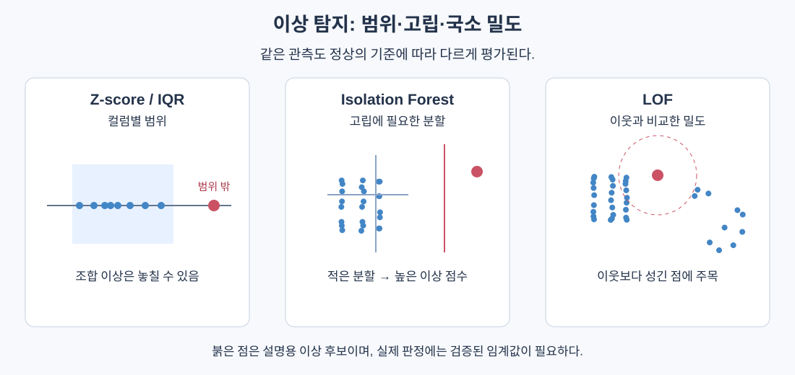
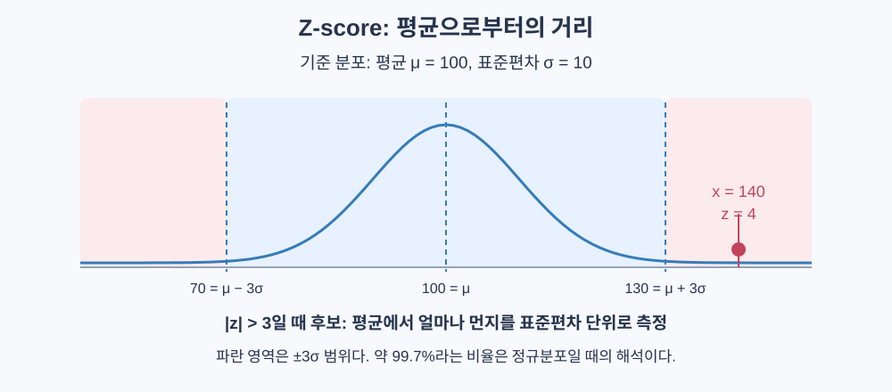
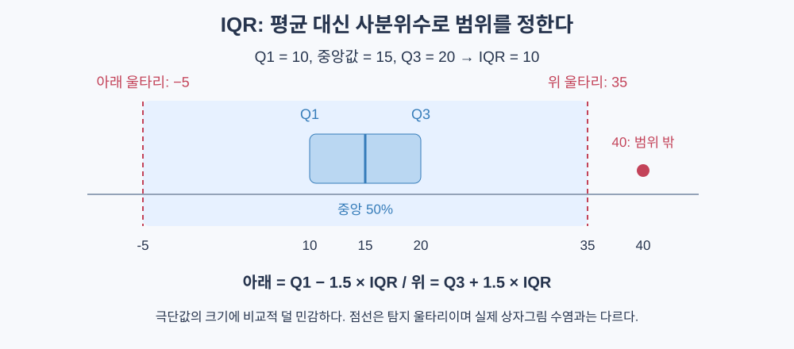
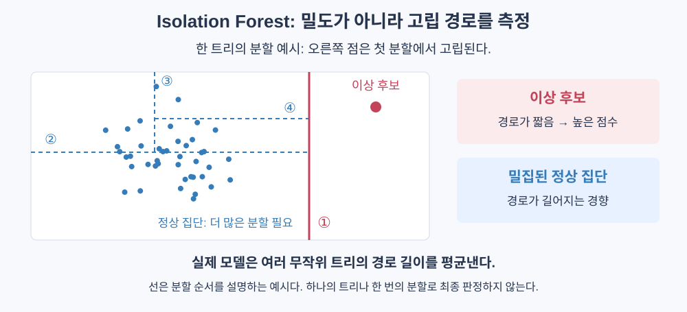
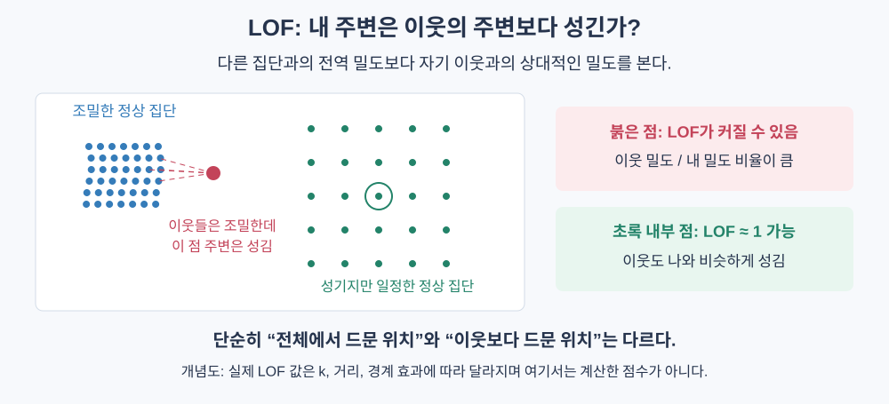

# 이상 탐지

> 알려진 이상 사례를 외우기보다 정상 패턴을 학습하고, 그 패턴에서 벗어나는 관측을 조사 대상으로 삼는다.

## 핵심 아이디어

이상 탐지(Anomaly Detection)는 기대하는 정상 패턴과 크게 다른 관측을 찾는 문제다. 사기 거래, 장비 고장, 서버 장애처럼 중요한 사건은 드물고 형태도 계속 바뀌므로, 충분한 이상 라벨을 구하기 어렵다.

그래서 “사기 거래의 특징을 배운다” 대신 “일반 거래의 패턴에서 얼마나 벗어나는가”를 점수화할 수 있다. 다만 **드문 것과 나쁜 것은 같지 않다**. 큰 금액의 정상 거래도 드물며, 평범하게 위장한 공격은 이상 점수가 낮을 수 있다.



탐지기는 의심 순위를 만들고, 임계값과 조사 과정이 실제 대응을 결정한다. 모델과 운영 정책을 함께 설계해야 한다.

## 이상은 세 종류가 있다

| 종류 | 의미 | 예 | 필요한 정보 |
|---|---|---|---|
| 점 이상 | 관측 하나가 비정상 | 센서의 극단적인 온도 | 개별 값과 정상 범위 |
| 맥락 이상 | 상황을 고려하면 비정상 | 평소 조용한 새벽의 높은 트래픽 | 시간, 위치, 사용자별 기준 |
| 집단 이상 | 묶음·순서가 비정상 | 짧은 시간에 연속된 로그인 실패 | 시간 창, 빈도, 순서 |

같은 온도도 계절에 따라 해석이 달라진다. 개별 요청량이 정상이어도 장시간 지속되면 공격일 수 있다. 점 이상 탐지기에 원시 값만 주고 모든 유형을 찾으라고 할 수는 없다.

## 라벨 상황에 따른 문제 설정

| 설정 | 학습 데이터 | 주의점 |
|---|---|---|
| 비지도 | 정상·이상이 섞인 무라벨 데이터 | 이상이 기준 분포를 오염시킬 수 있음 |
| 정상 데이터 기반 | 신뢰할 수 있는 정상 데이터 | 학습에 없던 정상 변형에도 오탐 가능 |
| 소량 라벨 활용 | 일부 정상·이상 확인 결과 | 임계값 검증 또는 학습 보조에 활용 |
| 지도 분류 | 양쪽의 충분한 라벨 | 알려진 유형 중심으로 최적화될 수 있음 |

원문은 소량 이상 라벨을 주로 평가에 사용하는 흐름을 설명한다. 실제로는 약지도 학습에 활용할 수도 있다. 비지도 방법도 새로운 이상을 모두 잡거나 분포 변화에 자동으로 강한 것은 아니다.

지도 분류와 비지도 탐지를 함께 사용하면, 알려진 위험 유형에 대한 정밀도와 새로운 패턴 탐지의 범위를 보완할 수 있다.

## Z-score: 평균에서 몇 표준편차 떨어졌는가



```text
z_j = (x_j - mu_j) / sigma_j
score(x) = max_j |z_j|
score(x) > threshold이면 이상 후보
```

평균과 표준편차는 기준 훈련 데이터에서 구하고 새 데이터에 고정해서 적용한다.

```text
정상 기준 평균 100, 표준편차 10
새 관측 140 -> z = (140-100)/10 = 4
threshold = 3이면 이상 후보
```

정규분포에서 약 99.7%가 평균 ±3 표준편차 안에 있다. 하지만 어떤 분포에나 3을 적용하면 같은 오탐률이 나오는 것은 아니다. Z-score 자체는 다른 분포에서도 계산되지만, 이 확률 해석에는 정규성 가정이 필요하다.

### 장점과 한계

- 빠르고, “평균보다 4 표준편차 높다”처럼 설명하기 쉽다.
- 극단값이 평균과 표준편차를 끌어올려 이상을 숨길 수 있다.
- 여러 정상 집단이나 꼬리가 긴 분포에서는 오탐이 커질 수 있다.
- 특징을 따로 보면 각 값은 정상이어도 조합이 이상인 경우를 놓친다.

특징 100개 각각의 오탐률이 작더라도, 하나만 넘으면 경보를 내는 방식의 전체 오탐률은 커진다. 독립이고 특징당 오탐 확률이 p라면 적어도 하나가 걸릴 확률은 `1 - (1-p)^100`이다.

## IQR: 중앙 50%를 기준으로 범위 정하기



```text
Q1 = 25% 분위수
Q3 = 75% 분위수
IQR = Q3 - Q1

lower = Q1 - a × IQR
upper = Q3 + a × IQR
```

보통 `a = 1.5`를 출발점으로 삼는다.

```text
Q1 = 10, Q3 = 20, IQR = 10
허용 범위 = [-5, 35]
40은 범위 밖의 이상 후보
```

평균·표준편차보다 극단값의 크기에 덜 민감하고 정규성을 요구하지 않는다. 하지만 분위수도 오염의 영향을 받으며, 왜도가 큰 분포에서 대칭적인 울타리를 적용하면 한쪽에 경보가 몰릴 수 있다.

다차원에 컬럼별로 적용할 수는 있지만, 특징들의 결합 관계를 학습하는 다변량 탐지기는 아니다. IQR이 0인 경우도 별도 정책이 필요하다.

## Isolation Forest: 적은 분할로 고립되는 점



### 직관

밀집된 정상 집단 안의 한 점을 분리하려면 여러 번 잘라야 한다. 다른 점들과 멀리 떨어진 관측은 몇 번의 무작위 분할만으로 혼자 남을 수 있다.

일반 결정 트리가 정답을 잘 구분하는 분할을 찾는다면, isolation tree는 **무작위 특징과 무작위 임계값**을 사용한다. 라벨이나 정보 이득이 필요하지 않다.

### 학습과 점수 계산

1. 훈련 데이터에서 크기 psi의 부분집합을 뽑는다.
2. 값이 변하는 특징과 분할점을 무작위로 고른다.
3. 좌우로 나누고 재귀적으로 반복한다.
4. 하나만 남거나 깊이 제한에 도달하면 멈춘다.
5. 여러 트리에서 새 점의 경로 길이를 구해 평균낸다.

```text
s(x, psi) = 2 ^ (-E[h(x)] / c(psi))

c(n) = 2 H_(n-1) - 2(n-1)/n       # n > 1
c(1) = 0
H_m = 1 + 1/2 + ... + 1/m
```

- `h(x)`: 고립에 필요한 경로 길이
- `c(psi)`: 표본 크기에 따른 기준 경로 길이
- 짧은 경로일수록 점수가 1에 가까워져 더 의심스럽다.
- `E[h] = c(psi)`이면 점수는 0.5다. 0.5가 모든 데이터의 확정적인 정상 기준은 아니다.

깊이 제한 때문에 여러 점이 한 잎에 남으면, 관측 경로 깊이에 `c(잎의 표본 수)`를 더해 아직 필요한 분할을 보정한다. 분모도 요청한 최대 크기보다 **실제로 트리에 사용한 표본 수**를 기준으로 해야 한다.

### 파라미터와 계산량

| 값 | 역할 |
|---|---|
| 트리 수 T | 점수의 무작위 변동과 계산 비용 조절 |
| 부분집합 크기 psi | 각 트리가 보는 정상 구조의 범위 |
| 최대 깊이 | 트리 크기 제한, 흔히 ceil(log2 psi) 사용 |
| contamination | 연속 점수를 이진 판정으로 바꾸는 기준 비율 |

균형 잡힌 분할과 깊이 제한을 가정하면 학습 비용은 대략 `O(T psi log psi)`, N개 점수 계산은 `O(N T log psi)`로 생각할 수 있다. 고차원에서도 사용할 수 있지만, 무관한 특징이 많으면 분할이 유용한 특징을 놓치기 쉽다.

`contamination`이 점수 모델과 별개로 임계값만 설정하는 구현에서는, 같은 데이터·난수·다른 파라미터를 유지하면 이 값만 바꿔도 점수 순위는 그대로다. 이것은 실제 이상 비율을 알아낸다는 뜻이 아니다.

범주형은 적절한 수치 표현이 필요하며, 임의의 정수 코드를 붙이면 범주 사이에 가짜 순서와 거리를 도입할 수 있다.

## LOF: 이웃에 비해 밀도가 낮은가



Local Outlier Factor는 전역적인 희소성보다 **자기 이웃에 비해 얼마나 희소한지**를 본다. 전체적으로 드문 집단이라도 내부 밀도가 일정하면 정상일 수 있다.

```text
reach_dist_k(x, o) = max(k_distance(o), distance(x, o))

lrd_k(x) = 1 / mean_(o in N_k(x)) reach_dist_k(x, o)

LOF_k(x) = mean_(o in N_k(x)) [lrd_k(o) / lrd_k(x)]
```

| 구성 | 의미 |
|---|---|
| N_k(x) | x의 이웃 집합 |
| k_distance(o) | o에서 k번째 이웃까지의 거리 |
| lrd | 도달 가능 거리로 계산한 국소 밀도 |
| LOF | 이웃 밀도 대비 내 밀도의 역비율 평균 |

`LOF ≈ 1`이면 이웃과 밀도가 비슷하다. 1보다 크게 높으면 자기 주변이 이웃 주변보다 성기다. k가 너무 작으면 잡음에 민감하고, 너무 크면 지역 구조를 뭉개므로 여러 k에서 확인한다.

거리를 사용하므로 특징 스케일과 고차원에서의 거리 의미가 중요하다. 단순한 모든 쌍 거리 계산은 `O(N² d)` 비용이 들 수 있다.

## 방법 비교

| 방법 | 정상의 기준 | 장점 | 놓치기 쉬운 경우 |
|---|---|---|---|
| Z-score | 평균과 표준편차 | 빠름, 설명 쉬움 | 왜도, 다봉 분포, 결합 이상 |
| IQR | 사분위수 범위 | 극단값에 비교적 강함 | 결합 이상, 여러 정상 집단 |
| Isolation Forest | 무작위 고립 경로 | 다변량, 부분집합 학습 | 국소 이상, 무관 특징 다수 |
| LOF | 이웃 대비 밀도 | 밀도가 다른 집단의 국소 이상 | 고차원, 큰 데이터, 부적절한 거리 |

원문이 덧붙이는 One-Class SVM은 정상 집단의 경계를, 오토인코더는 정상 데이터의 재구성 패턴을 학습한다. `nu` 같은 파라미터를 실제 이상 비율과 정확히 동일하다고 해석하면 안 된다. 정상과 이상이 재구성 오차로 언제나 분리되는 것도 아니다.

## 희귀 사건에서 정확도가 위험한 이유

이상 비율 0.1%인 10만 건에 실제 이상이 100개 있다고 하자.

```text
전부 정상 예측 -> 정확도 99.9%, 이상 recall 0%

이상 중 80개 탐지, 정상 중 1%를 오탐:
TP = 80, FP = 999
precision = 80 / 1079 ≈ 7.4%
recall = 80 / 100 = 80%
```

오탐률 1%도 실제 조사량으로는 매우 클 수 있다. ROC 곡선만으로는 이런 운영 부담을 읽기 어렵다.

| 지표 | 질문 |
|---|---|
| Precision@k | 가장 의심스러운 k개 중 실제 이상은 몇 개인가? |
| AUPRC | 여러 임계값에서 precision과 recall의 관계는 어떤가? |
| Recall at fixed FPR | 허용 오탐률 안에서 얼마나 잡는가? |
| 일별 경보 수 | 조사 인력이 감당할 수 있는가? |

라벨이 없으면 precision·recall을 실제로 계산할 수 없다. 상위 경보뿐 아니라 일부 비경보 표본도 조사해야 놓친 이상을 추정하기 쉬워진다.

## 점수와 임계값은 분리해서 생각한다

모델은 의심 순위를 만들고, 임계값은 조사 비용과 미탐 비용을 반영한다.

```text
cost(threshold) = C_FP × FP + C_FN × FN
```

현재 정의처럼 큰 점수가 의심스러운 경우 임계값을 낮추면 더 많은 경보를 낸다. recall은 줄지 않지만 precision은 데이터에 따라 변하며, 반드시 단조롭게 떨어지는 것은 아니다.

앙상블에서는 먼저 점수 방향과 척도를 맞춘다. 평균 점수나 여러 탐지기의 합의를 사용할 수 있지만, 모두의 동의를 요구하면 오탐과 함께 탐지율도 줄 수 있다. 공통된 실패 원인이 있으면 합의가 정답을 보장하지 않는다.
