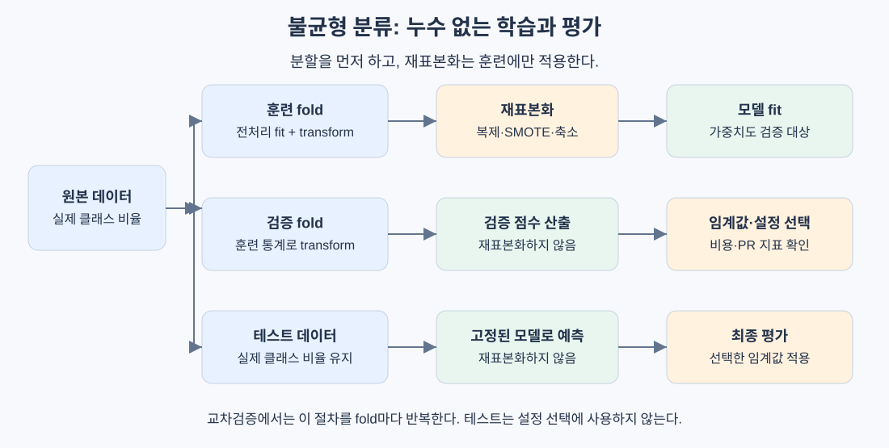
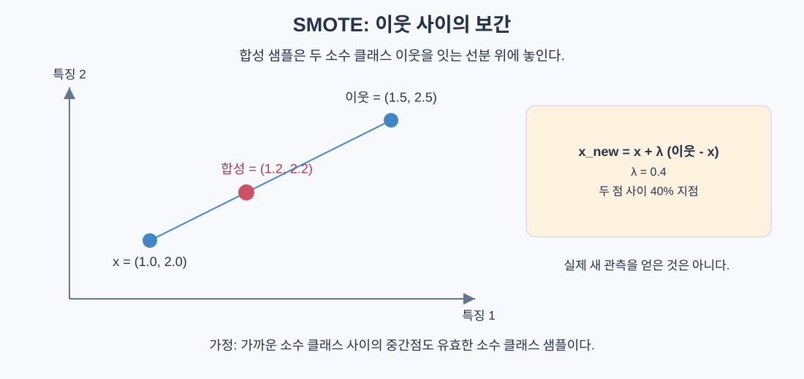

# 불균형 데이터 다루기

> 드문 양성을 놓치는 모델은 높은 정확도를 얻을 수 있다. 중요한 것은 클래스 비율을 맞추는 행위보다 탐지 목표와 평가 기준을 맞추는 것이다.

## 핵심 아이디어

불균형 분류는 클래스별 샘플 수가 크게 다른 문제다. 사기 거래, 결함, 침입처럼 관심 있는 양성이 전체의 일부인 경우가 많다.

일반적인 학습 손실은 샘플별 오차를 합하므로 다수 클래스가 결과에 큰 영향을 준다. 모델이 소수 클래스를 잘 구분하더라도 기본 임계값 0.5에서는 거의 양성을 예측하지 않을 수도 있다.

대응 방법은 세 층으로 나눠 생각하면 쉽다.

| 바꾸는 대상 | 방법 | 의미 |
|---|---|---|
| 학습 데이터 | 오버샘플링, 언더샘플링, SMOTE | 모델이 보는 샘플 분포 변경 |
| 학습 목적 | 클래스 가중치, 비용 민감 학습 | 어떤 오류를 더 비싸게 볼지 변경 |
| 의사결정 | 임계값 조정 | 점수를 양성·음성으로 바꾸는 규칙 변경 |



비율만 보고 SMOTE·가중치·임계값 조정을 모두 결합할 필요는 없다. 먼저 실제 분포에서 기준선을 만들고, 각 방법이 주는 이득과 오탐 비용을 비교한다.

## 왜 정확도만으로는 부족한가

1000개 샘플 중 음성 990개, 양성 10개인 상황에서 전부 음성으로 예측하면:

| 실제 / 예측 | 양성 예측 | 음성 예측 |
|---|---|---|
| 실제 양성 | TP = 0 | FN = 10 |
| 실제 음성 | FP = 0 | TN = 990 |

```text
Accuracy = (TP + TN) / N = 990 / 1000 = 99%
Recall = TP / (TP + FN) = 0 / 10 = 0%
```

관심 사건은 하나도 찾지 못했다. 정확도는 여전히 올바른 계산이지만, 이 문제의 목표를 충분히 표현하지 못한다.

## 소수 클래스의 성능을 읽는 지표

### Precision, Recall, F1

```text
Precision = TP / (TP + FP)           # 양성 경보 중 실제 양성 비율
Recall = TP / (TP + FN)              # 실제 양성 중 탐지한 비율
F1 = 2PR / (P + R)
   = 2TP / (2TP + FP + FN)
```

예를 들어 실제 양성 10개 중 8개를 잡고 잘못된 경보 12개를 냈다면:

```text
TP = 8, FN = 2, FP = 12, TN = 978
Precision = 8/20 = 0.4
Recall = 8/10 = 0.8
F1 = 16/30 ≈ 0.533
Accuracy = 986/1000 = 0.986
```

정확도는 전부 음성 모델보다 낮아졌지만 중요한 양성 8개를 찾았다. 이것이 더 좋은지는 양성 탐지의 가치와 오탐 비용에 달려 있다.

양성 예측이 없으면 precision의 분모가 0이다. 보고할 때 정의 불가로 표시할지 0으로 처리할지 명시해야 한다.

### F-beta

```text
F_beta = (1 + beta^2) PR / (beta^2 P + R)
```

- `beta > 1`: recall을 더 중시한다.
- `beta < 1`: precision을 더 중시한다.
- `beta = 1`: F1이다.

F1은 진음성 TN을 직접 사용하지 않으며 실제 오류 비용을 그대로 표현하지도 않는다. 오탐 비용이 높은 문제에는 비용이나 precision 제약을 함께 본다.

### AUPRC와 MCC

| 지표 | 보는 것 | 주의점 |
|---|---|---|
| AUPRC | 임계값 전반의 precision-recall 관계 | 양성 비율이 다른 데이터끼리 단순 비교 주의 |
| MCC | 실제·예측 라벨의 상관 | 퇴화한 예측에서는 분모 0 처리 필요 |

```text
MCC = (TP×TN - FP×FN)
      / sqrt((TP+FP)(TP+FN)(TN+FP)(TN+FN))
```

MCC는 -1부터 1 사이이며, 1은 완전 일치, -1은 완전 반대다. 모두 음성 예측하는 경우 수식은 정의되지 않지만 구현에서는 흔히 0으로 처리한다.

무작위 순위의 PR 기준선은 양성 비율에 해당한다. 양성률이 1%라면 기준 수준은 약 0.01이다. 유한 표본과 면적 계산 방식에 따라 수치가 달라질 수 있다. Average Precision(AP)과 PR 곡선을 사다리꼴로 적분한 면적도 동일한 계산은 아니므로 사용한 방식을 기록한다.

ROC-AUC는 순위 성능을 보여주지만, 음성이 매우 많으면 작은 FPR도 많은 오탐을 뜻한다. PR 지표와 실제 경보 수를 함께 본다.

## Random Oversampling과 Undersampling

### 오버샘플링: 소수 클래스 복제

양성 50개, 음성 950개라면 양성에서 복원추출해 훈련 데이터를 늘린다.

장점은 원본을 버리지 않고 구현이 단순하다는 점이다. 단점은 새로운 정보가 생기는 것은 아니며, 같은 사례의 반복이 과적합과 학습 시간 증가를 일으킬 수 있다는 점이다.

### 언더샘플링: 다수 클래스 일부만 사용

음성에서 일부를 뽑아 양성과 개수를 맞춘다. 학습은 빨라지지만, 드문 정상 패턴이나 경계 부근의 유용한 음성을 버릴 수 있다.

여러 음성 부분집합으로 모델을 학습해 합치는 balanced bagging은 이런 손실을 일부 보완할 수 있다. 어느 방법도 반드시 1:1까지 맞춰야 하는 것은 아니다. 표본 비율 자체도 검증할 설정이다.

## SMOTE: 소수 클래스 사이를 보간한다

### 알고리즘과 수식

1. 소수 클래스 샘플 x를 고른다.
2. 다른 소수 클래스 샘플 중 k개 이웃을 찾는다.
3. 이웃 하나 x_neighbor를 고른다.
4. 두 점 사이에 합성 샘플을 만든다.

```text
x_new = x + lambda (x_neighbor - x)
lambda ~ Uniform(0, 1)
```

```text
x = (1.0, 2.0)
x_neighbor = (1.5, 2.5)
lambda = 0.4

x_new = (1.0, 2.0) + 0.4 × (0.5, 0.5)
      = (1.2, 2.2)
```

합성 점은 선분 위에 있다. SMOTE는 실제 새 관측을 얻은 것이 아니라, **가까운 소수 클래스 사이도 같은 클래스일 것이라는 가정**으로 훈련 공간을 채운다.



### 주의점

| 상황 | 위험 |
|---|---|
| 클래스가 겹침 | 보간 선분이 다수 클래스 영역을 통과 |
| 소수 클래스에 오라벨·이상치 존재 | 잘못된 패턴 주변을 확장 |
| 특징 스케일 차이가 큼 | 거리에서 큰 단위의 특징이 지배 |
| 범주형·one-hot 입력 | 0.4 같은 값이 실제 범주가 아님 |
| 소수 샘플이 매우 적음 | 이웃 구조를 신뢰하기 어려움 |
| 고차원 희소 텍스트 | 거리·보간 결과의 의미가 약할 수 있음 |

연속 좌표 사이의 중간점이 현실적으로 가능한 데이터인지 확인해야 한다. 정수 개수, 상호 제약이 있는 특징, 시간 순서가 있는 기록은 단순 보간이 부적절할 수 있다.

## 클래스 가중치: 데이터 대신 손실을 바꾼다

클래스 c에 흔히 사용하는 균형 가중치는:

```text
w_c = N / (K × N_c)
```

양성 50개, 음성 950개인 이진 문제라면:

```text
w_negative = 1000 / (2×950) ≈ 0.526
w_positive = 1000 / (2×50) = 10
양성 한 개의 가중치 / 음성 한 개의 가중치 = 19
```

이 가중치는 전체 훈련 데이터에서 각 클래스가 손실에 기여하는 총량을 같게 만든다.

### 가중 로지스틱 손실과 그래디언트

```text
p_i = sigmoid(w^T x_i + b)
a_i = 샘플 i의 클래스 가중치

L = -(1/N) sum_i a_i [y_i log p_i + (1-y_i) log(1-p_i)]

grad_w = (1/N) X^T [a * (p-y)]
grad_b = (1/N) sum_i a_i (p_i-y_i)
```

`a * (p-y)`는 원소별 곱이다. 소수 클래스의 오차가 업데이트에 더 큰 영향을 준다.

복제는 경험 손실에서 샘플 가중치를 늘리는 것과 연결되지만, 무작위 샘플링·정규화·손실 정규화·학습 알고리즘에 따라 결과까지 동일하지는 않다. 가중치도 과도하면 오탐을 늘리거나 오라벨에 민감해질 수 있다.

SMOTE로 이미 균형을 맞춘 뒤 원본 비율의 가중치를 또 적용하면 소수 클래스를 과하게 강조할 수 있다. 두 방법을 결합하려면 어떤 분포에서 가중치를 계산하는지부터 명시한다.

## 임계값 조정: 순위와 판정 분리

```text
p(x) >= threshold이면 양성
```

0.5는 기본값일 뿐이다. 검증 데이터에서 threshold를 바꾸며 F1, 비용, 최소 precision, 경보 수 등을 비교한다.

1. 훈련 데이터로 모델을 학습한다.
2. 원래 클래스 비율의 검증 데이터에서 점수를 얻는다.
3. 후보 임계값별 지표를 계산한다.
4. 운영 목표를 만족하는 값을 정한다.
5. 고정한 모델·임계값을 테스트 데이터에 평가한다.

임계값을 내리면 양성 예측 집합은 커지고 recall은 줄지 않는다. FP도 늘거나 유지되지만, precision은 표본 구성에 따라 오르내릴 수 있다. 순위가 나쁘면 임계값만 바꿔 해결할 수 없다.

원문의 `0.05~0.95` 탐색은 예시다. 실제 적절한 값이 그 범위 밖일 수 있으므로 예측 점수의 고유 값이나 분위수를 후보로 삼을 수 있다.

## 비용을 알면 기대 비용으로 판단한다

오탐 비용 `C_FP`, 미탐 비용 `C_FN`, 정답 비용 0을 가정하자. p가 실제 운영 분포에서 보정된 양성 확률이면:

```text
양성 예측의 기대 비용 = C_FP × (1-p)
음성 예측의 기대 비용 = C_FN × p

양성 예측 조건:
C_FP(1-p) <= C_FN p
p >= C_FP / (C_FP + C_FN)
```

미탐 비용이 100, 오탐 비용이 1이면 비용 기준 임계값은 `1/101 ≈ 0.0099`다. 이는 확률이 보정되어 있고 위 비용 가정이 성립할 때의 결과다. 조사 인력 제한이나 샘플별 비용 차이가 있으면 정책이 달라진다.

### 재표본화와 확률 보정

샘플링이나 가중치는 모델이 학습하는 클래스 비율·손실을 바꾼다. 출력 0.5를 원래 운영 분포의 양성 확률 50%로 해석하기 어려울 수 있다.

따라서 검증·테스트는 실제 비율을 유지하고, 필요하면 별도 검증 또는 교차검증으로 보정한다. 보정은 확률의 의미를, 임계값 선택은 행동 규칙을 다룬다. 단조증가 보정은 순위를 유지하므로 순위 성능 자체를 개선하지는 않는다.

## 누수 없는 전체 흐름

| 단계 | 해야 할 일 |
|---|---|
| 문제 정의 | 양성 라벨, 비용, 최소 recall 또는 precision 정하기 |
| 분할 | 독립 표본은 층화, 사용자·시간 의존성은 그룹·시간 기준 |
| 훈련 fold | 전처리 fit 후 필요시 재표본화하고 모델 학습 |
| 검증 fold | 훈련 통계로 변환만 수행, 샘플 수·비율 유지 |
| 설정 선택 | 방법·비율·가중치·임계값 검증 |
| 최종 평가 | 고정된 설정을 손대지 않은 테스트에서 평가 |
| 운영 | 유병률·사건 비율, 경보 수, precision·recall 변화 추적 |

**분할 전에 SMOTE나 복제를 하면 안 된다.** 같은 원본의 복사본이나 그 점에서 파생된 합성 샘플이 훈련과 검증 양쪽에 들어가 독립적인 평가를 망칠 수 있다.

전처리의 거리 척도가 중요하면 훈련 fold에서만 scaler를 fit한 뒤 SMOTE를 적용한다. 검증·테스트에는 scaler의 transform만 하고 SMOTE는 적용하지 않는다.

원문의 imbalanced-learn은 학습 시에만 재표본화하는 파이프라인을 제공한다. 저장소 실습에서는 허용 목록 밖의 설치 코드는 생략한다: **stays stdlib-first for educational clarity.**
