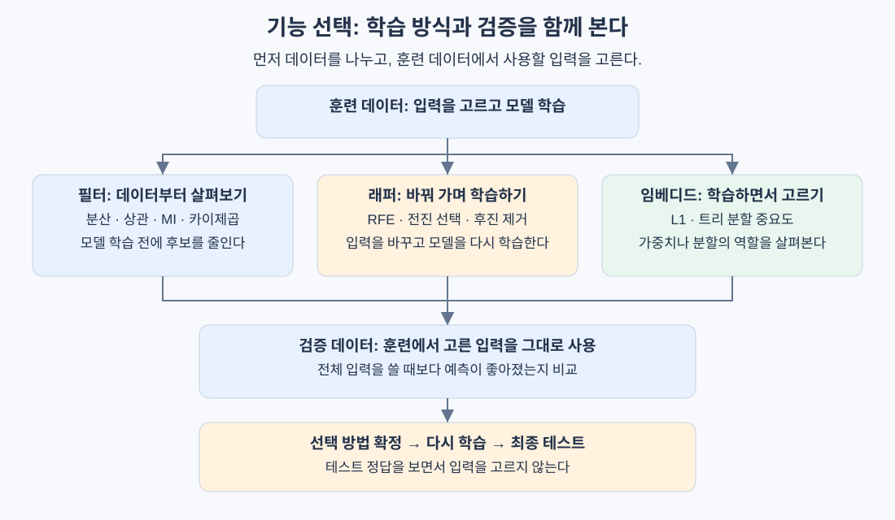

# 기능 선택

> 모델에 줄 정보를 무조건 늘리기보다, 예측에 도움이 되는 정보부터 골라 보자.

## 핵심 아이디어: 집값 예측에 필요한 정보 고르기

집값을 예측하는 모델을 만든다고 하자. 데이터에는 다음과 같은 열이 있다.

| 집 면적 | 방 개수 | 지하철까지 거리 | 면적의 평 단위 값 | 매물 번호 | 국가 | 집값 |
|---|---|---|---|---|---|---|
| 84㎡ | 3 | 500m | 약 25.4평 | 10001 | 한국 | 8억 |
| 59㎡ | 2 | 1200m | 약 17.8평 | 10002 | 한국 | 5억 |

여기서 **예측에 넣는 입력 항목을 기능(feature)**이라고 부르기로 한다. 집 면적과 방 개수는 기능이고, 맞히려는 정답인 집값은 타깃(target)이다.

모든 입력이 똑같이 유용하지는 않다.

- **집 면적·방 개수·역까지 거리**: 집값을 예측하는 데 도움이 될 수 있다.
- **면적의 평 단위 값**: ㎡ 면적과 같은 정보를 다른 단위로 반복한다.
- **매물 번호**: 단순한 식별 번호라면 새 집의 가격을 예측하는 데 도움이 되기 어렵다.
- **국가**: 모든 행이 한국이면, 이 데이터 안에서 집을 구별하지 못한다.

**기능 선택(Feature Selection)은 이렇게 기존 입력 중 사용할 항목을 고르는 일이다.** 입력이 줄면 학습이 빨라지고 설명하기 쉬워질 수 있다. 우연한 패턴을 외우는 과적합도 줄일 수 있다.

다만 많이 지울수록 좋은 것은 아니다. 예측에 필요한 정보를 지우면 성능이 나빠진다. 따라서 선택 전후를 같은 조건에서 비교해야 한다.

### 비슷한 개념과 구분하기

| 개념 | 집값 예시 | 하는 일 |
|---|---|---|
| 기능 공학 | 건축 연도로부터 건물 나이 계산 | 새로운 입력 만들기 |
| 기능 선택 | 매물 번호를 빼고 면적은 남기기 | 기존 입력 중 고르기 |
| 차원 축소 | 여러 입력을 섞어 새 좌표 만들기 | 입력을 다른 표현으로 압축하기 |

기능 선택은 원래 열을 그대로 남기므로 “이 모델은 면적과 거리로 예측한다”처럼 설명하기 쉽다.

## 세 가지 방법: 무엇을 보고 고를까?

같은 입력을 고르더라도 판단하는 방식이 다르다.

| 방식 | 쉬운 설명 | 대표 방법 |
|---|---|---|
| 필터(Filter) | 모델을 학습하기 전에 데이터의 숫자·관계를 보고 고른다 | 분산, 상관, 상호정보량 |
| 래퍼(Wrapper) | 모델을 여러 번 학습하면서 사용할 입력을 바꾼다 | RFE, 전진 선택 |
| 임베디드(Embedded) | 모델이 학습하는 과정에서 입력의 역할을 줄이거나 중요도를 구한다 | L1, 트리 중요도 |

예를 들어 전원이 한국인 열을 제거하는 데는 모델이 필요 없다. 반면 “면적과 방 개수 중 무엇을 빼는 편이 나을까?”는 모델을 학습해 판단할 수 있다.



아래에서는 **어떻게 고르는지 → 왜 그런지 → 무엇을 조심할지** 순서로 살펴본다. 수식은 설명한 과정을 숫자로 표현한 것이다.

## 분산 필터: 값이 거의 안 바뀌는 열부터 확인한다

### 분산이란?

분산은 **값들이 평균에서 얼마나 퍼져 있는지** 나타내는 숫자다.

```text
A = [3, 3, 3, 3]      -> 모두 같음: 분산 0
B = [1, 3, 5, 7]      -> 서로 다름: 분산이 0보다 큼
```

모든 집의 국가가 같으면 그 열로 비싼 집과 싼 집을 구별할 수 없다. 이런 열은 먼저 제거할 수 있다.

```text
평균 = 모든 값의 합 / 데이터 개수
분산 = 각 값에 대해 (값 - 평균)^2을 구한 뒤 평균낸 값

분산이 정한 기준보다 크면 유지한다.
```

수식으로는 다음과 같다. n은 행 개수, x_i는 i번째 값, mu는 평균이다.

```text
mu = (1/n) sum_i x_i
Var(X) = (1/n) sum_i (x_i - mu)^2
```

### 낮은 분산이면 무조건 지워도 될까?

아니다. 1000건 중 한 번 켜지는 `긴급 결함 감지` 열은 거의 항상 0이지만, 그 한 번이 중요할 수 있다. **완전히 같은 열은 쉽게 제거할 수 있지만, 거의 같은 열은 의미를 확인해야 한다.**

또한 분산은 단위에 따라 달라진다. 같은 금액도 원으로 기록하면 숫자가 크고 천 원으로 기록하면 작다. 단위가 다른 열에 하나의 분산 기준을 그대로 적용하는 것은 조심해야 한다.

## 상관 필터: 비슷한 정보를 반복하는 열 줄이기

상관은 **두 값이 함께 커지거나, 하나가 커질 때 다른 하나가 작아지는 경향**을 나타낸다. 여기서는 직선에 가까운 관계를 보는 Pearson 상관을 말한다.

| 상관계수 | 의미 |
|---|---|
| 1에 가까움 | 한쪽이 커지면 다른 쪽도 커지는 경향 |
| -1에 가까움 | 한쪽이 커지면 다른 쪽은 작아지는 경향 |
| 0에 가까움 | 뚜렷한 직선 관계가 없음 |

㎡ 면적과 평 면적은 단위만 다르므로 상관계수가 1이다. 둘 다 넣어도 새로운 정보가 생기지 않으므로 하나만 남길 수 있다.

```text
corr(X, Y) = Cov(X, Y) / (std(X) × std(Y))

Cov: 두 값이 함께 변하는 정도인 공분산
std: 각 값의 표준편차
```

실제로는 `|상관계수| > 0.9`처럼 기준을 정하고, 비슷한 열 중 측정이 쉽거나 결측값이 적은 것을 남길 수 있다. 0.9는 예시일 뿐 고정 규칙은 아니다.

주의할 점은 **상관 0이 아무 관계도 없다는 뜻은 아니라는 것**이다. 직선이 아닌 관계를 보려면 다음 방법이 도움이 된다. 모든 값이 같은 열은 표준편차가 0이라 상관계수를 계산할 수 없으므로 먼저 처리한다.

## 상호정보량(MI): 이 값을 알면 정답을 더 잘 알 수 있을까?

### 상관과 무엇이 다른가?

X가 -1, 0, 1이고 정답이 `Y = X²`라고 하자.

| X | -1 | 0 | 1 |
|---|---|---|---|
| Y | 1 | 0 | 1 |

X가 커질 때 Y는 내려갔다가 올라간다. 일관되게 증가하거나 감소하는 직선 관계가 아니어서 이 세 점의 상관은 0이다.

그런데 X를 알려주면 Y는 정확히 계산할 수 있다. **직선 관계는 없어도 예측에 필요한 정보는 있는 것**이다.

상호정보량(Mutual Information, MI)은 이런 관계도 찾는다. 질문은 “X를 알았을 때 Y를 얼마나 덜 헷갈리게 되는가?”다.

```text
MI = Y에 대해 원래 모르던 정도
     - X를 알고도 여전히 모르겠는 정도

I(X; Y) = H(Y) - H(Y | X)
```

H는 불확실성의 크기인 엔트로피다. MI가 0이면 두 변수가 독립이고, 양수이면 서로 관련된 정보가 있다는 뜻이다. 실제 데이터에서는 추정 오차 때문에 점수를 단정적으로 해석하면 안 된다.

### 직접 구현할 때는 구간별로 센다

원문은 연속적인 값을 구간(bin)으로 나누고 빈도를 센다. 예를 들어 면적을 `소형 / 중형 / 대형`으로 나누고 각 구간의 집값 등급 분포를 살펴보는 방식이다.

```text
I(X; Y) = sum_x sum_y p(x,y) log[p(x,y) / (p(x)p(y))]

p(x,y): X와 Y가 해당 조합으로 함께 나오는 비율
p(x), p(y): 각각 해당 값이 나오는 비율
sum: 가능한 조합의 계산 결과를 모두 더한다는 뜻
```

둘이 무관하면 함께 나오는 비율이 `p(x)p(y)`와 같아져 로그 안이 1이 되고, 기여도는 0이다. 자연로그를 쓰면 MI 단위는 nat이다.

구간이 너무 적으면 세부 관계를 놓치고, 너무 많으면 몇 개의 우연한 관측에 흔들린다. 구간 수와 남길 기능 수는 검증으로 정한다.

### 하나씩 보는 방법의 한계

어떤 정보는 둘을 함께 봐야 유용하다. 예를 들어 서로 독립인 두 공정한 동전에서 **앞뒷면이 같으면 0, 다르면 1**을 정답으로 삼아 보자.

동전 하나만 알려주면 정답은 여전히 반반이다. 두 동전을 모두 알려주면 정답을 안다. 개별 MI만 보고 두 입력을 지우면 이 조합을 놓친다. 이것을 기능 간 **상호작용**, 즉 함께 있을 때 생기는 효과라고 한다.

## RFE: 하나씩 빼면서 다시 학습하기

RFE(Recursive Feature Elimination)는 **학습 → 중요도 확인 → 가장 약한 입력 제거**를 반복한다.

집값 입력이 면적, 방 개수, 역까지 거리, 매물 번호 네 개라면:

1. 네 개로 모델을 학습한다.
2. 모델의 계수나 트리 중요도를 확인한다.
3. 매물 번호의 중요도가 가장 낮다면 제거한다.
4. 남은 세 개로 모델을 다시 학습한다.
5. 원하는 개수만 남을 때까지 반복한다.

다시 학습하는 이유는 하나를 빼면 나머지의 역할이 달라질 수 있기 때문이다. 면적 정보를 두 열로 나눠 쓰던 모델도 한쪽이 없어지면 남은 면적 열에 더 의존할 수 있다.

### 장점과 비용

사용할 모델을 기준으로 고를 수 있지만 학습을 반복해야 한다.

```text
500개에서 10개까지 하나씩 제거:
제거 판단을 위한 학습 = 500 - 10 = 490회
마지막 10개로 최종 모델까지 학습하면 총 491회
```

여러 개씩 제거하면 빨라지지만 유용한 입력까지 한꺼번에 버릴 위험이 있다. 또한 RFE가 모든 조합을 찾아보는 것은 아니므로 가장 좋은 조합을 보장하지 않는다.

원문은 로지스틱 회귀 **계수의 절댓값**으로 중요도를 정한다. 각 제거 후보의 검증 점수를 전부 비교하는 방식은 아니다. 남길 개수와 최종 성능은 별도 검증으로 확인한다. 계수 크기를 비교할 때는 입력 단위를 맞추는 것도 중요하다.

### 비슷한 방법: 전진 선택

전진 선택은 반대로 시작한다. 아무 입력도 없는 상태에서 후보를 하나씩 넣어 보고, 검증 점수가 가장 좋아지는 것을 추가한다.

| 방법 | 다음 입력을 고르는 질문 |
|---|---|
| RFE | 지금 모델에서 가장 덜 중요한 입력은 무엇인가? |
| 전진 선택 | 무엇을 추가하면 검증 점수가 가장 좋아지는가? |
| 후진 제거 | 무엇을 빼면 검증 점수가 가장 좋아지는가? |

성능은 기본 모델의 능력에도 달려 있다. 단순한 직선 모델로 RFE를 한다고 복잡한 조합 관계까지 자동으로 찾는 것은 아니다.

## L1: 쓰지 않아도 되는 입력의 가중치를 0으로 만들기

### 가중치 0이 왜 선택인가?

선형 집값 모델이 다음과 같다고 하자. 숫자는 설명을 위한 예시다.

```text
예측 집값 = 3 × 면적 + 2 × 방 개수 + 0 × 매물 번호 + 기본값
```

매물 번호에 무엇이 들어와도 `0 × 매물 번호 = 0`이다. 이 입력은 예측에 영향을 주지 않으므로 빼도 된다.

L1은 모델이 틀린 정도뿐 아니라 **가중치 크기에도 벌점**을 주는 방법이다.

```text
전체 손실 = 예측 오차 + alpha × 가중치 절댓값의 합
L = L_data + alpha sum_j |w_j|
```

- `L_data`: 모델이 정답을 얼마나 틀리는지 나타내는 손실
- `w_j`: j번째 입력에 곱하는 가중치
- `alpha`: 가중치에 주는 벌점의 강도

예측을 거의 개선하지 못하면서 가중치만 차지하는 입력은 줄이는 편이 유리해진다. L1은 일부 가중치를 정확히 0으로 만들 수 있다. 반면 L2는 대체로 가중치를 작게 줄이되 정확히 0으로 만들지는 않는다.

### 직접 구현의 핵심: 작으면 0, 크면 조금 줄이기

원문은 예측 오차를 줄이는 방향으로 가중치를 움직인 뒤, 다음 규칙을 적용한다. 이를 soft-thresholding이라고 한다.

```text
한 번에 줄일 크기 = learning_rate × alpha

업데이트 직후 값이  0.03이고 줄일 크기가 0.05 -> 0
업데이트 직후 값이 -0.20이고 줄일 크기가 0.05 -> -0.15
```

작은 값은 0이 되고 큰 값은 부호를 유지한 채 0에 가까워진다. 수식의 v는 예측 오차를 줄이도록 먼저 업데이트한 가중치다.

```text
w_j = sign(v_j) × max(|v_j| - learning_rate × alpha, 0)
```

alpha를 너무 크게 잡으면 필요한 입력까지 사라진다. 입력마다 단위가 다르면 벌점이 불공평해질 수 있으므로, 훈련 데이터의 평균·표준편차로 단위를 맞추는 표준화를 고려한다.

서로 비슷한 입력 중 무엇을 남길지도 데이터에 따라 바뀔 수 있다. L1과 L2를 함께 쓰는 Elastic Net은 이런 불안정성을 줄이는 데 도움이 될 수 있다.

원문 직접 구현은 **L1을 적용한 로지스틱 분류 모델**이다. Lasso는 보통 제곱 오차를 쓰는 회귀 모델에 L1을 적용한 경우를 가리킨다.

## 트리 중요도: 정답을 잘 나누는 데 사용했는가?

결정 트리는 “면적이 80㎡보다 큰가?” 같은 질문으로 데이터를 나눈다. 나눈 뒤 각 그룹의 집값이 더 비슷해지면 좋은 질문이다.

분류라면 같은 그룹에 정답 클래스가 얼마나 섞여 있는지를 본다. 이 섞인 정도가 **불순도**다. 회귀에서는 그룹 안의 정답 값이 얼마나 퍼져 있는지 볼 수 있다.

```text
분할 이득 = 나누기 전 불순도
            - 나눈 뒤 불순도의 가중 평균

가중 평균: 데이터가 많은 그룹에 더 큰 비중을 주어 계산한 평균
```

면적으로 나눈 질문이 여러 곳에서 큰 이득을 냈다면 면적의 중요도가 높아진다.

```text
기능 j의 중요도 원점수
= 그 기능으로 나눈 각 지점의 (데이터 수 × 분할 이득)을 모두 더한 값
```

비교하기 쉽게 원점수를 전체 합으로 나누면 중요도 합이 1이 된다. 전체 이득이 0이면 따로 처리해야 한다.

주의할 점은 **훈련 데이터를 잘 나눈 것과 새로운 데이터를 잘 예측하는 것이 다를 수 있다는 것**이다. 매물 번호처럼 서로 다른 값이 많은 열은 나눌 위치를 많이 시도할 수 있어, 우연히 높은 중요도를 얻기도 한다.

그래서 다음 방법으로 새 데이터에서도 실제로 도움이 되는지 확인한다.

## 순열 중요도: 입력을 뒤섞으면 얼마나 못 맞힐까?

순열 중요도(Permutation Importance)는 **이미 학습한 모델을 그대로 두고, 검증 데이터의 열 하나만 섞어 보는 방법**이다.

면적 열을 집들 사이에서 무작위로 섞으면 각 집에 엉뚱한 면적이 붙는다. 그때 예측이 크게 나빠진다면 모델이 올바른 면적 정보에 의존하고 있었다는 뜻이다.

```text
정확도 기준 예시:
원래 정확도 = 0.90
면적을 섞은 뒤 평균 정확도 = 0.72
면적의 순열 중요도 = 0.90 - 0.72 = 0.18
```

```text
중요도 = 원래 점수 - 섞은 뒤 점수의 평균
```

큰 값이 좋은 지표에서의 식이다. 오차처럼 작은 값이 좋은 지표라면 `섞은 뒤 오차 - 원래 오차`로 계산한다.

| 결과 | 읽는 방법 |
|---|---|
| 크게 나빠짐 | 현재 모델이 그 입력을 많이 활용한다 |
| 거의 그대로 | 잘 쓰지 않거나, 다른 입력이 대신할 수 있다 |
| 오히려 좋아짐 | 잡음·과적합·우연한 변동 등을 확인한다 |

섞을 때마다 결과가 달라지므로 여러 번 반복해 평균과 변동을 본다. 모델을 다시 학습할 필요는 없다.

단, ㎡ 면적과 평 면적이 둘 다 있으면 하나를 섞어도 다른 하나가 대신할 수 있다. 따라서 중요도가 낮다고 면적 정보 자체가 불필요하다고 판단하면 안 된다. 열을 섞어 현실에 없는 조합이 생길 수도 있다는 점도 기억한다.

## 가장 중요한 실수: 정답을 미리 보고 고르기

시험 문제의 정답을 미리 보고 공부할 항목을 고르면 시험 점수가 실력을 제대로 보여주지 못한다. 기능 선택도 같다.

전체 데이터의 정답을 보고 MI 상위 기능을 고른 뒤 훈련·검증을 나누면, 검증 정답이 이미 선택에 영향을 준다. 이것이 **데이터 누수**다. 실제 새 데이터보다 성능이 좋아 보일 수 있다.

### 올바른 순서

1. **먼저 나눈다.** 학습용 훈련 데이터, 설정 선택용 검증 데이터, 최종 평가용 테스트 데이터를 분리한다.
2. **훈련 데이터에서 고른다.** 평균·표준편차, MI 점수, 남길 열 등을 훈련 데이터로만 구한다.
3. **검증에는 같은 규칙을 적용한다.** 훈련에서 면적과 거리만 남겼다면 검증에서도 그 두 열만 사용한다.
4. **선택 전후를 비교한다.** 같은 검증 데이터에서 전체 입력 모델과 선택한 입력 모델을 평가한다.
5. **설정을 고정한다.** 남길 개수와 alpha 등을 정한 후, 훈련·검증을 합친 개발 데이터로 다시 학습한다.
6. **테스트로 최종 평가한다.** 테스트 결과를 보며 선택 규칙을 계속 바꾸지 않는다.

교차검증은 훈련·검증 역할을 바꾸어 여러 번 평가하는 방식이다. 각 분할을 fold라고 하며, **매번 해당 훈련 fold 안에서 기능 선택부터 다시 해야 한다.** 정답을 사용하지 않는 분산 필터와 표준화도 훈련에서만 학습한다.

## 어떤 방법부터 써볼까?

| 상황 | 출발점 | 이유 |
|---|---|---|
| 값이 같은 열이 많음 | 분산 필터 | 학습 없이 쉽게 정리 가능 |
| 비슷한 열이 많음 | 상관 확인 | 중복 정보를 줄일 후보 발견 |
| 입력이 너무 많음 | MI 등으로 후보를 줄인 뒤 모델 기반 선택 | 비싼 반복 학습의 부담 감소 |
| 선형 모델에서 입력을 줄이고 싶음 | 표준화 + L1 | 학습 중 일부 가중치를 0으로 만듦 |
| 트리 모델을 사용함 | 트리 중요도 + 검증 순열 중요도 | 훈련 중요도와 실제 의존도를 함께 확인 |
| 입력이 적고 계산 여유가 있음 | RFE·전진 선택 | 모델을 반복 학습해 선택 가능 |

모든 방법을 순서대로 적용할 필요는 없다. 먼저 전체 입력으로 기준 모델을 만들고, 가장 단순한 선택부터 비교한다. 선택 후 성능이 나빠지면 덜 제거하거나 전체 입력을 유지해도 된다.
